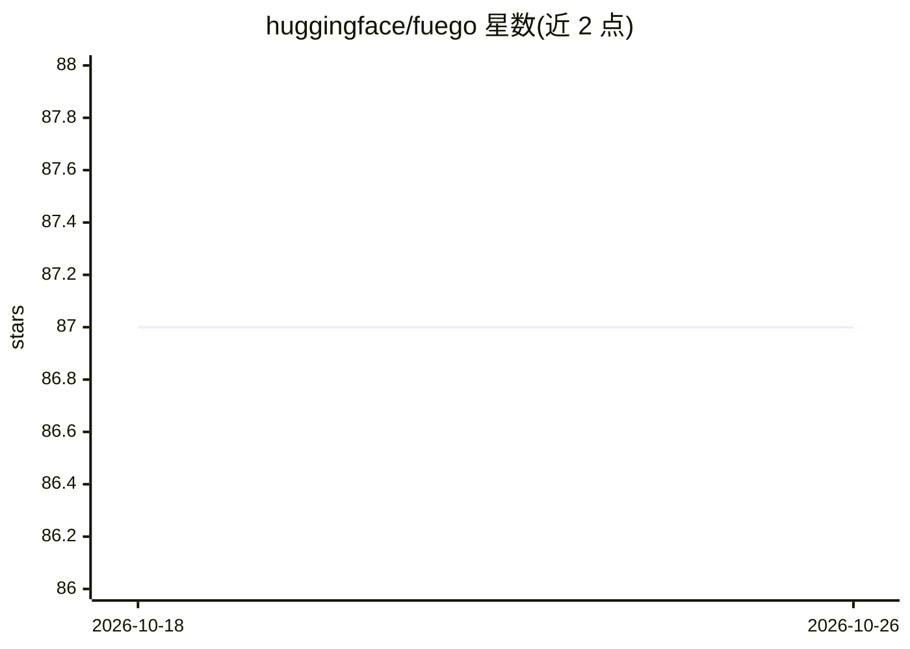

# huggingface/fuego

⭐ 87 · Python · Apache-2.0 · 推送 2026-09-23 · [GitHub](https://github.com/huggingface/fuego) · 组织维护

**在 Hugging Face Spaces 上运行脚本的云执行工具（WIP）**

Hugging Face 维护的项目，定位为在云端运行代码的接口，具体机制为在 Hugging Face Spaces 上运行脚本。提供 Python API 与 CLI 两种相似的使用方式，安装方式为 git clone 后 pip install -e 源码安装。README 明确声明该项目为 WIP、仅为想法、正在积极开发中，API 处于草案状态。CLI 示例支持指定脚本、requirements 文件与消息参数。examples 文件夹提供更多示例。

## 筛选速览

| 维度 | 判定 | 备注 |
|---|---|---|
| AI 角色 | `ai-ecosystem` | LLM/agent 周边工具 |
| 许可风险 | `permissive` | Apache-2.0 |
| 部署形态 | `library` | 以包/库形式分发 |
| 模型依赖 | — | README 未给出锁定关系 |
| 硬件要求 | — | 无带数字的原话,不猜 |
| 安装摩擦 | `low` | 无编译、无系统依赖或容器化 |
| 成熟度 | `idea` | |

## 能力要点

- 在 Hugging Face Spaces 上运行脚本的接口
- 提供 Python API 与 CLI 两种使用方式
- CLI 支持指定脚本、依赖文件与运行消息

## 适用场景

- 把自己的 Python 脚本放到 Hugging Face Spaces 上运行
- 通过 CLI 或 Python API 提交脚本与依赖文件

## 场景标签

 · 领域:开发工具/云计算

## 证据(README 行号)

> L3: A 🔥 tool for running code in the cloud
> L15: A nice interface for running scripts on Hugging Face Spaces

## 星数曲线

2026-10-18 87 → 2026-10-26 87（+0）

---
*卡片 v1 · prompt 1.4 · 生成 2026-10-23 · 置信度 low · 依据 README sha `1e7ffd0c71fb` · [字段定义](../../DATASET.md)*
