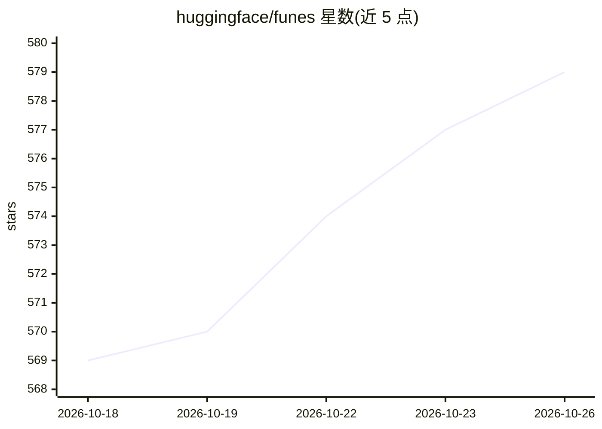

# huggingface/funes

⭐ 579 · Rust · Apache-2.0 · 推送 2026-10-22 · [GitHub](https://github.com/huggingface/funes) · 组织维护

**AI 编码代理的持久会话记忆：跨代理索引并可发布到 Hub**

Rust 编写的 CLI 工具，将 Claude Code、Codex、pi、Hermes 等编码代理的会话转录解析为统一 turns 格式，分块后写入本地 Lance 数据集并用固定的本地嵌入模型向量化；检索融合向量与 BM25 并多次重排，为代理提供 recall/get 工具和逐轮索引钩子。记忆可作为 Hugging Face 数据集发布与共享，推送前有凭据脱敏与密钥拦截门。用户可通过 funes ask 借用代理基于记忆作答。支持 curl 安装脚本下载预编译二进制，源码构建需 Rust 工具链与 protoc。

## 筛选速览

| 维度 | 判定 | 备注 |
|---|---|---|
| AI 角色 | `ai-ecosystem` | LLM/agent 周边工具 |
| 许可风险 | `permissive` | Apache-2.0 |
| 部署形态 | `None` |  |
| 模型依赖 | — | README 未给出锁定关系 |
| 硬件要求 | — | 无带数字的原话,不猜 |
| 安装摩擦 | `medium` | 含编译或系统依赖之一 |
| 成熟度 | — | 结构信号不足 |

## 能力要点

- 跨 Claude Code/Codex/pi/Hermes 统一索引，检索命中显示来源代理
- 记忆以 Hugging Face 数据集形式发布与共享（默认私有）
- 向量+BM25 融合检索与重排，嵌入/重排用固定本地模型
- 发布前自动脱敏凭据并有常驻密钥拦截门

## 适用场景

- 让编码代理在任务中自动回忆过往决策与理由
- 切换编码代理工具时保留完整历史记忆
- 将团队/项目的会话记忆发布为数据集供他人或他机检索

## 场景标签

`Agent 记忆` `语义搜索` · 领域:Agent 开发

## 证据(README 行号)

> L3: **Durable memory for your AI coding agents.** `funes` indexes your past sessions across Claude
> L14: - **Your agent recalls your past work.** The model spontaneously uses `funes` to recall prior decisions, rationale,
> L150: is parsed into a generic turn/block shape, chunked, written to a local Lance dataset, and embedded

## 星数曲线

2026-10-18 569 → 2026-10-26 579（+10）

---
*卡片 v1 · prompt 1.4 · 生成 2026-10-21 · 置信度 high · 依据 README sha `e88a1d135b4a` · [字段定义](../../DATASET.md)*
