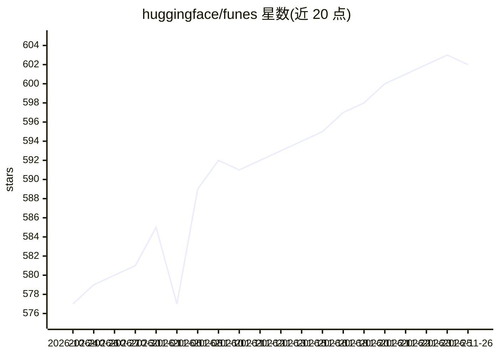

# huggingface/funes

⭐ 602 · Rust · Apache-2.0 · 推送 2026-11-25 · [GitHub](https://github.com/huggingface/funes) · 组织维护

**为 AI 编码 agent 提供跨会话持久记忆索引与召回**

funes 将 Claude Code、Codex、pi、Hermes 等编码 agent 的历史会话解析为统一 turns 格式，分块后写入本地 Lance 数据集并用固定本地模型嵌入；召回时融合向量与 BM25 检索，再经 cross-encoder 重排。记忆可发布为 Hugging Face 数据集仓库供他机或他人召回，发布时有凭据脱敏门控；也可借用 agent 对记忆提问获得标注来源的回答。本地嵌入/重排后端无 ML 运行时依赖，macOS 可用 Metal GPU。

## 筛选速览

| 维度 | 判定 | 备注 |
|---|---|---|
| AI 角色 | `ai-ecosystem` | LLM/agent 周边工具 |
| 许可风险 | `permissive` | Apache-2.0 |
| 部署形态 | `None` |  |
| 模型依赖 | — | README 未给出锁定关系 |
| 硬件要求 | — | 无带数字的原话,不猜 |
| 安装摩擦 | `medium` | 含编译或系统依赖之一 |
| 成熟度 | — | 结构信号不足 |

## 能力要点

- 多个编码 agent 的会话索引进单一记忆，跨 agent 召回并标注来源
- 本地记忆可发布为 Hugging Face 数据集，支持 push/recall 远程读取
- 向量+BM25 融合检索并 cross-encoder 重排的确定性流水线
- 发布门控自动脱敏凭据，数据集默认私有

## 适用场景

- 让编码 agent 在任务中回忆此前的决策与结论
- 跨机器、跨 agent 延续同一份工作记忆
- 查阅并检索他人公开发布的项目过程记忆

## 场景标签

`Agent 记忆` `语义搜索` · 领域:Agent 开发

## 证据(README 行号)

> L5: **Durable memory for your AI coding agents.** `funes` indexes your past sessions across Claude
> L86: Models work the same way. funes runs pinned local embedding and reranking models, but no generative
> L153: with a pinned local model; recall fuses vector + BM25 search, and reranks the pool with a cross-encoder.

## 星数曲线

2026-10-24 577 → 2026-11-26 602（+25）

---
*卡片 v1 · prompt 1.4 · 生成 2026-11-26 · 置信度 high · 依据 README sha `83901ab7f1e0` · [字段定义](../../DATASET.md)*
