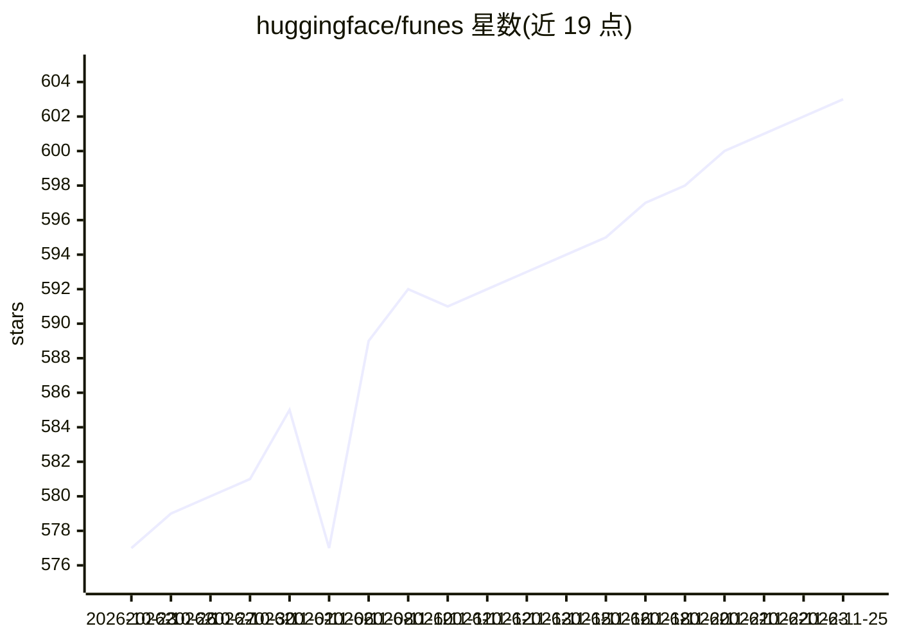

# huggingface/funes

⭐ 603 · Rust · Apache-2.0 · 推送 2026-11-23 · [GitHub](https://github.com/huggingface/funes) · 组织维护

**给 AI 编码 agent 建可检索持久记忆库，跨工具召回历史会话**

Rust 编写的命令行工具：将 Claude Code、Codex、pi、Hermes 等编码 agent 的历史会话索引为本地 Lance 数据集，解析为统一 turns 格式后分块、嵌入；召回时融合向量与 BM25 检索并用交叉编码器重排。记忆可作为数据集发布到 Hugging Face Hub，供其他机器或团队成员远程召回；发布前有凭证脱敏门控。内置本地嵌入与重排模型，无自有生成模型；提供预编译二进制安装，也可从源码构建（需 Rust 与 protoc）。

## 筛选速览

| 维度 | 判定 | 备注 |
|---|---|---|
| AI 角色 | `ai-ecosystem` | LLM/agent 周边工具 |
| 许可风险 | `permissive` | Apache-2.0 |
| 部署形态 | `None` |  |
| 模型依赖 | — | README 未给出锁定关系 |
| 硬件要求 | — | 无带数字的原话,不猜 |
| 安装摩擦 | `medium` | 含编译或系统依赖之一 |
| 成熟度 | — | 结构信号不足 |

## 能力要点

- 跨多个 agent 的单一记忆，召回命中标注来源 agent
- 向量+BM25 融合检索并用本地重排模型精排
- 记忆发布为 Hugging Face Hub 数据集，支持 `funes ask` 借用 agent 生成有出处的回答
- 发布门控自动脱敏凭证，数据集默认私有

## 适用场景

- 让编码 agent 在任务中自动召回此前的决策与结论
- 在 Claude Code 与 Codex 之间切换而保留完整工作历史
- 把个人 agent 会话发布给团队或公开供他人查询

## 场景标签

`Agent 记忆` · 领域:Agent 开发

## 证据(README 行号)

> L3: **Durable memory for your AI coding agents.** `funes` indexes your past sessions across Claude
> L150: is parsed into a generic turn/block shape, chunked, written to a local Lance dataset, and embedded
> L151: with a pinned local model; recall fuses vector + BM25 search, and reranks the pool with a cross-encoder.

## 星数曲线

2026-10-23 577 → 2026-11-25 603（+26）

---
*卡片 v1 · prompt 1.4 · 生成 2026-11-25 · 置信度 high · 依据 README sha `7679b61e0107` · [字段定义](../../DATASET.md)*
