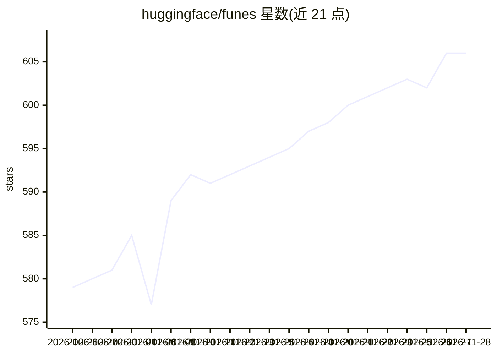

# huggingface/funes

⭐ 606 · Rust · Apache-2.0 · 推送 2026-11-27 · [GitHub](https://github.com/huggingface/funes) · 组织维护

**为 AI 编码 agent 提供可检索、可发布的会话记忆库**

以 Rust 编写的命令行工具：将 Claude Code、Codex、pi、Hermes 等编码 agent 的历史会话索引为本地 Lance 数据集，向 agent 注入 recall/get 工具与 session-end hook，使其可在任务中自动检索过去的决策与依据。索引管线将各 agent 转录转为统一 turns 格式，分块、嵌入，检索时融合向量与 BM25 并用 cross-encoder 重排。记忆可作为数据集发布到 Hugging Face Hub（默认私有），并带凭据脱敏门控；通过 funes ask 可借用某个 agent 生成带来源的答案。

## 筛选速览

| 维度 | 判定 | 备注 |
|---|---|---|
| AI 角色 | `ai-ecosystem` | LLM/agent 周边工具 |
| 许可风险 | `permissive` | Apache-2.0 |
| 部署形态 | `desktop` | 安装包/桌面程序 |
| 模型依赖 | locked-api |  |
| 硬件要求 | — | 无带数字的原话,不猜 |
| 安装摩擦 | `medium` | 含编译或系统依赖之一 |
| 成熟度 | — | 结构信号不足 |

## 能力要点

- 多 agent 共享单一记忆：Claude Code/Codex/pi/Hermes 交叉检索并标注来源
- 发布记忆到 Hugging Face Hub，他人可用 --memory 直接召回
- 向量+BM25 融合检索与 cross-encoder 重排，内置本地嵌入/重排模型
- 发布前凭据脱敏门控，提供 MCP 通用客户端接入

## 适用场景

- 让编码 agent 在任务中自动回顾此前的设计决策与理由
- 跨机器、跨团队共享 agent 会话记忆
- 在 Claude Code 与 Codex 之间切换任务而不丢上下文

## 场景标签

`Agent 记忆` · 领域:Agent 开发

## 证据(README 行号)

> L5: **Durable memory for your AI coding agents.** `funes` indexes your past sessions across Claude
> L160: `funes add` runs one loop: **index** what you've done, **recall** it when it matters — and index what
> L59: One command onboards you: your agent gets `recall` and `get` as tools, and — for Claude, Codex, and

## 星数曲线

2026-10-26 579 → 2026-11-28 606（+27）

---
*卡片 v1 · prompt 1.4 · 生成 2026-11-28 · 置信度 mid · 依据 README sha `565a80fcb9fc` · [字段定义](../../DATASET.md)*
