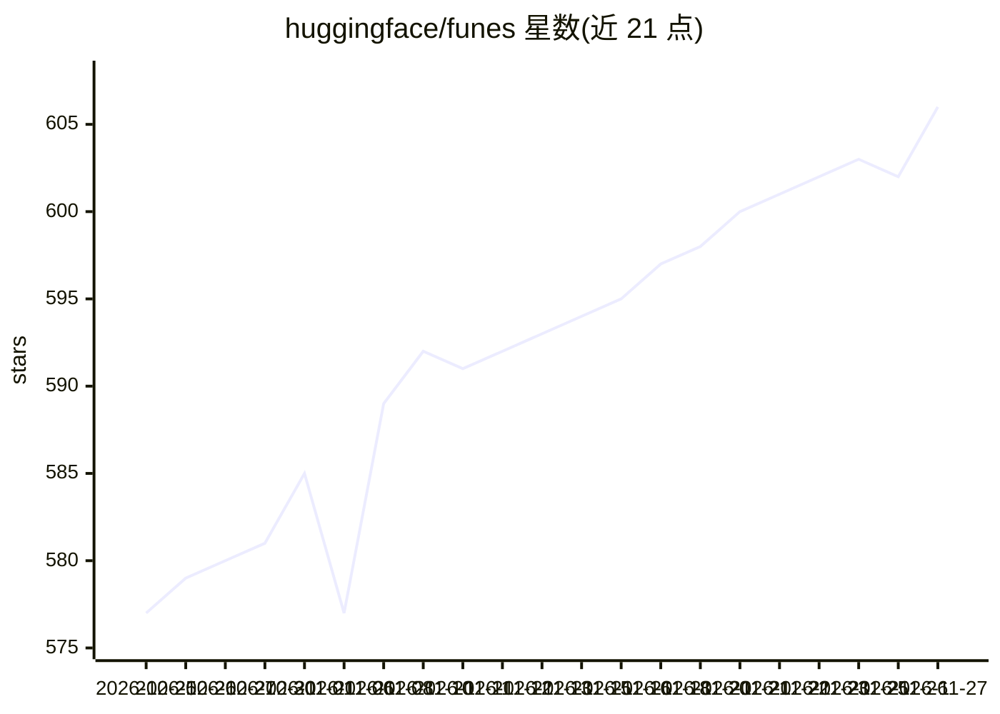

# huggingface/funes

⭐ 606 · Rust · Apache-2.0 · 推送 2026-11-26 · [GitHub](https://github.com/huggingface/funes) · 组织维护

**为 AI 编码 agent 提供跨工具、可检索、可发布的会话记忆**

用 Rust 编写的 CLI 工具，把 Claude Code、Codex、pi、Hermes 四个 agent 的历史会话解析为统一 turns 格式，分块后写入本地 Lance 数据集并用固定本地嵌入模型向量化；检索时融合向量与 BM25 并用交叉编码器重排。支持把记忆发布为 Hugging Face 数据集仓库供他人或他机检索，发布前有凭据脱敏门控。通过脚本安装预编译二进制，也可用 Rust 工具链源码构建。

## 筛选速览

| 维度 | 判定 | 备注 |
|---|---|---|
| AI 角色 | `ai-ecosystem` | LLM/agent 周边工具 |
| 许可风险 | `permissive` | Apache-2.0 |
| 部署形态 | `desktop` | 安装包/桌面程序 |
| 模型依赖 | — | README 未给出锁定关系 |
| 硬件要求 | — | 无带数字的原话,不猜 |
| 安装摩擦 | `medium` | 含编译或系统依赖之一 |
| 成熟度 | — | 结构信号不足 |

## 能力要点

- 跨 Claude Code/Codex/pi/Hermes 的单一记忆，命中标注来源 agent
- 本地嵌入+BM25 融合检索与交叉编码器重排的确定性流水线
- 记忆以数据集形式发布到 Hugging Face Hub，私有默认
- 内置凭据脱敏门控，发布前拦截无法脱敏内容

## 适用场景

- 让编码 agent 在任务中途回忆此前的决策与结论
- 在多个 agent 工具间切换而不丢失历史上下文
- 把项目开发过程作为数据集分享给队友或其他机器上的 agent

## 场景标签

`Agent 记忆` · 领域:Agent 开发

## 证据(README 行号)

> L5: **Durable memory for your AI coding agents.** `funes` indexes your past sessions across Claude
> L159: is parsed into a generic turn/block shape, chunked, written to a local Lance dataset, and embedded
> L160: with a pinned local model; recall fuses vector + BM25 search, and reranks the pool with a cross-encoder.

## 星数曲线

2026-10-25 577 → 2026-11-27 606（+29）

---
*卡片 v1 · prompt 1.4 · 生成 2026-11-27 · 置信度 high · 依据 README sha `692b6b8e0138` · [字段定义](../../DATASET.md)*
