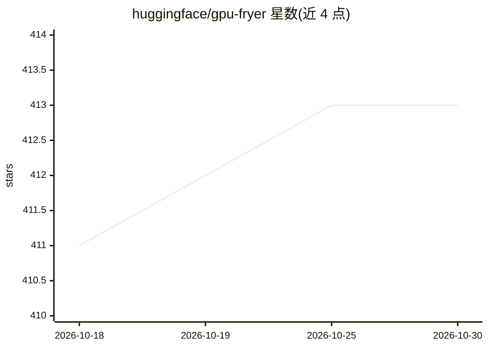

# huggingface/gpu-fryer

⭐ 413 · Rust · Apache-2.0 · 推送 2026-09-24 · [GitHub](https://github.com/huggingface/gpu-fryer) · 组织维护

**GPU 压力测试工具：检测热降频与性能劣化**

Hugging Face 维护的 GPU 压力测试工具：通过 CUBLAS 执行 8192x8192 矩阵乘法并占用 95% 显存做环形写入，逐卡输出 Gflops/s、温度与硬件/软件降频标志，检查多卡系统性能同质性并报告异常。适用于跑 ML 推理/训练的集群巡检，Hugging Face 用其监控自有 HPC 集群。依赖 NVIDIA CUDA 与 NVML，以 Docker 镜像或 cargo 安装，仅支持 NVIDIA GPU。无绝对性能指标，README 附各型号参考 TFLOPS 表。

## 筛选速览

| 维度 | 判定 | 备注 |
|---|---|---|
| AI 角色 | `ai-ecosystem` | LLM/agent 周边工具 |
| 许可风险 | `permissive` | Apache-2.0 |
| 部署形态 | `self-host` | docker 或自建部署 |
| 模型依赖 | — | README 未给出锁定关系 |
| 硬件要求 | — | 无带数字的原话,不猜 |
| 安装摩擦 | `low` | 无编译、无系统依赖或容器化 |
| 成熟度 | — | 结构信号不足 |

## 能力要点

- CUBLAS 矩阵乘法压测，可切换 FP32/BF16/FP8 精度
- NVML 监控温度与硬件/软件降频标志
- 多卡系统同质性检查，报告性能劣化
- 占用 95% 显存环形写入压力测试

## 适用场景

- ML 集群上线前检测 GPU 热降频与性能劣化
- 排查多卡系统中拖慢整体性能的慢卡
- HPC 集群定期健康巡检

## 场景标签

 · 领域:GPU/硬件运维工具

## 证据(README 行号)

> L4: It is especially useful to test GPUs running ML inference or training workloads for which
> L7: We use it at Hugging Face 🤗 to monitor our HPC clusters and ensure that all GPUs are running at peak performance.

## 星数曲线

2026-10-18 411 → 2026-10-30 413（+2）

---
*卡片 v1 · prompt 1.4 · 生成 2026-10-21 · 置信度 mid · 依据 README sha `7c4d0f0cc9e2` · [字段定义](../../DATASET.md)*
