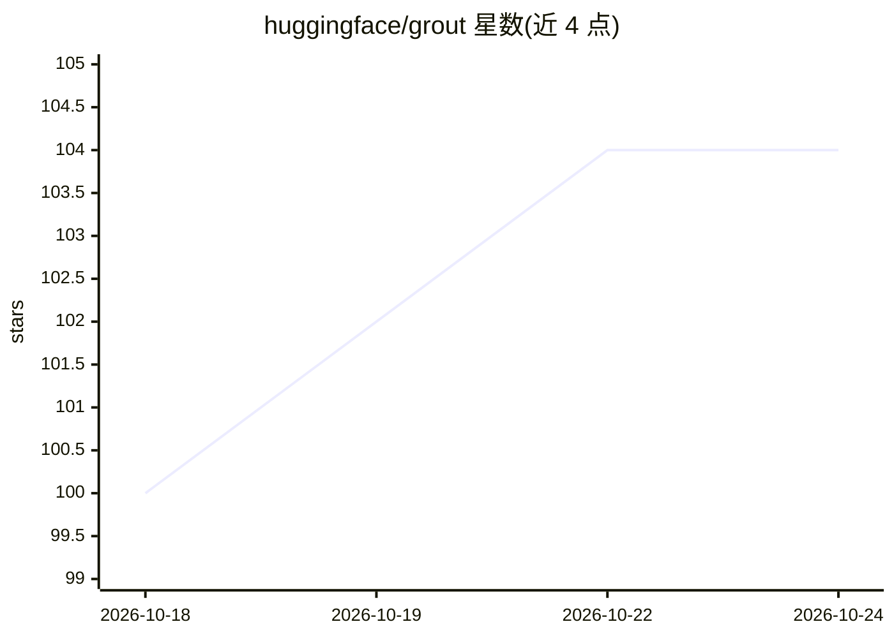

# huggingface/grout

⭐ 104 · Rust · Apache-2.0 · 推送 2026-10-07 · [GitHub](https://github.com/huggingface/grout) · 组织维护

**基于 cuTile Rust 的 Qwen3 GPU 推理引擎与基准测试床**

HuggingFace 维护的 LLM 推理引擎测试床：针对 Qwen3 模型（4B/32B），GPU 内核用 cuTile Rust DSL 编写（Rust→MLIR→PTX→CUBIN），线性投影走 cuBLAS。执行采用 StepGraph IR，decode 阶段捕获为 CUDA graph 重放；支持 SafeTensors 权重 mmap 加载、贪心/采样生成与 per-op profiling。要求 CUDA 13.2+（推荐 13.3+），基准测试默认对比 SGLang 与 vLLM，适配 RTX 5090（sm_120）与 B200（sm_100）。

## 筛选速览

| 维度 | 判定 | 备注 |
|---|---|---|
| AI 角色 | `ai-ecosystem` | LLM/agent 周边工具 |
| 许可风险 | `permissive` | Apache-2.0 |
| 部署形态 | `None` |  |
| 模型依赖 | — | README 未给出锁定关系 |
| 硬件要求 | — | 无带数字的原话,不猜 |
| 安装摩擦 | `high` | 编译与系统依赖俱全 |
| 成熟度 | — | 结构信号不足 |

## 能力要点

- GPU 内核以 cuTile Rust DSL 编写，首跑编译后缓存
- StepGraph IR + CUDA graph 重放的 decode 执行路径
- 融合内核：Q/K norm+RoPE+KV 写入、flash attention、split-K 等
- 内置 paper-facing 基准测试流程，默认对比 SGLang/vLLM

## 适用场景

- 在 RTX 5090/B200 上运行 Qwen3 推理并做基准测试
- 研究 cuTile Rust 编译流程下的 GPU 内核性能
- 对比不同推理引擎的 TG/PP 吞吐表现

## 场景标签

`推理引擎` · 领域:训练与推理

## 证据(README 行号)

> L3: Qwen3 inference engine built on
> L85: The engine uses a **StepGraph IR** — a sequence of ops (GEMM, RmsNorm, RoPE, Attention, etc.) compiled once per seq
> L115: It compares Grout against SGLang and vLLM by default, with llama.cpp and

## 星数曲线

2026-10-18 100 → 2026-10-24 104（+4）

---
*卡片 v1 · prompt 1.4 · 生成 2026-10-23 · 置信度 high · 依据 README sha `3745ec33a256` · [字段定义](../../DATASET.md)*
