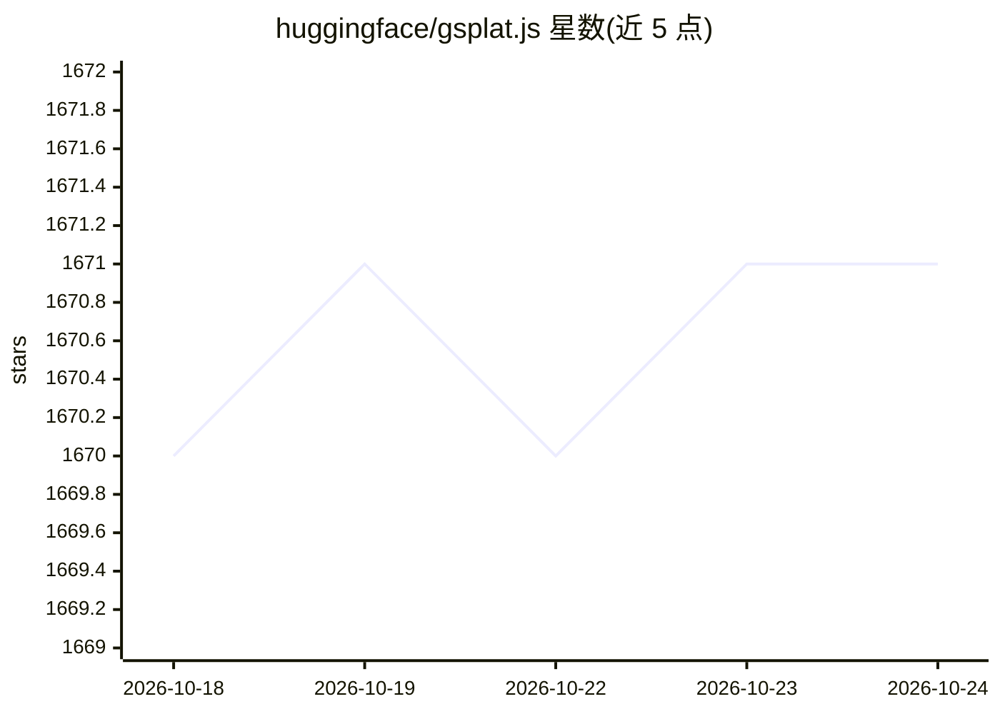

# huggingface/gsplat.js

⭐ 1,671 · TypeScript · MIT · 推送 2026-09-24 · [GitHub](https://github.com/huggingface/gsplat.js) · 组织维护

**JavaScript 的 3D Gaussian Splatting 渲染库，面向 Web 开发者**

开源的通用 3D Gaussian Splatting JavaScript 库，定位与 three.js 类似但面向 Gaussian Splatting 数据：提供场景创建、从 URL 加载 splat 数据与渲染循环的组件，并支持 .ply 与 .splat 格式互转（.splat 不含 SH 系数，颜色不随视角变化）。面向支持 ES6 模块的 Web 开发者，经 npm 安装，可配合 Vite 等打包器使用；另提供在线 Viewer 与 Editor 演示。

## 筛选速览

| 维度 | 判定 | 备注 |
|---|---|---|
| AI 角色 | `ai-ecosystem` | LLM/agent 周边工具 |
| 许可风险 | `permissive` | MIT |
| 部署形态 | `library` | 以包/库形式分发 |
| 模型依赖 | — | README 未给出锁定关系 |
| 硬件要求 | — | 无带数字的原话,不猜 |
| 安装摩擦 | `low` | 无编译、无系统依赖或容器化 |
| 成熟度 | — | 结构信号不足 |

## 能力要点

- 提供场景创建、加载 splat 数据与渲染循环的组件化 API
- 支持 .ply 与 .splat 格式及两者互转
- 提供在线 Viewer、Editor 演示与 jsfiddle 代码示例
- MIT 许可发布，基于多个开源项目构建

## 适用场景

- 在网页中渲染 3D Gaussian Splatting 数据
- 构建可实时更新与编辑 splat 场景的编辑器应用
- 将 .ply 点云转换为加载更快的 .splat 格式

## 场景标签

 · 领域:图形渲染/3D 可视化

## 证据(README 行号)

> L3: #### JavaScript Gaussian Splatting library
> L5: gsplat.js is an easy-to-use, general-purpose, open-source 3D Gaussian Splatting library, providing functionality sim

## 星数曲线

2026-10-18 1,670 → 2026-10-24 1,671（+1）

---
*卡片 v1 · prompt 1.4 · 生成 2026-10-21 · 置信度 high · 依据 README sha `8595f3d7898f` · [字段定义](../../DATASET.md)*
