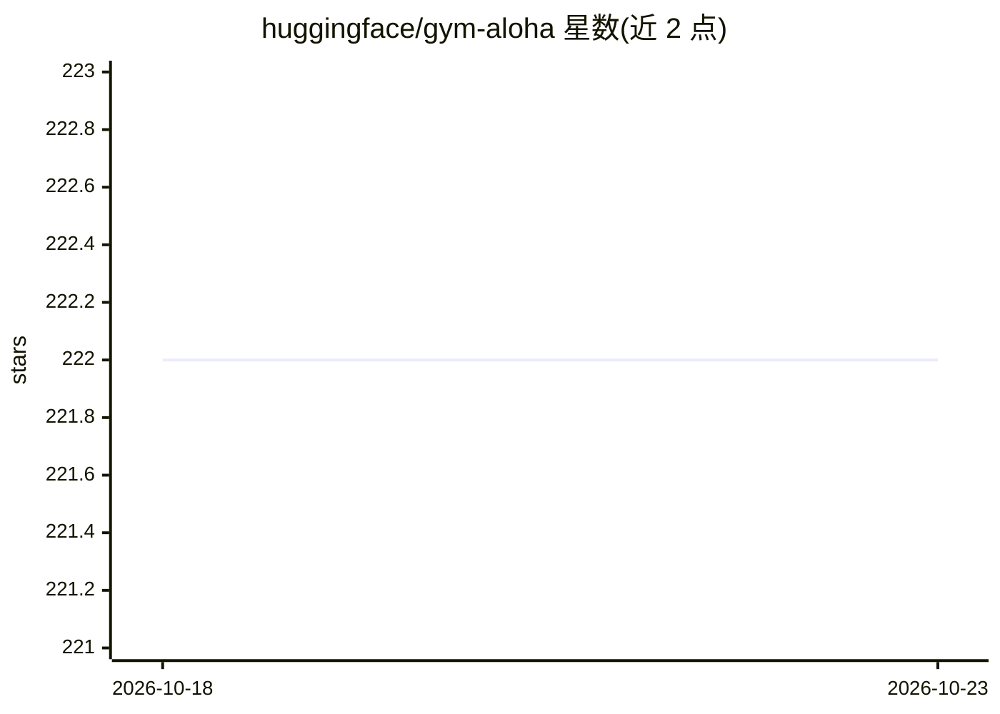

# huggingface/gym-aloha

⭐ 222 · Python · Apache-2.0 · 推送 2026-10-12 · [GitHub](https://github.com/huggingface/gym-aloha) · 组织维护

**ALOHA 双臂机器人操作的 Gymnasium 仿真环境**

基于 Gymnasium 与 MuJoCo 的机器人操作仿真环境，实现 ALOHA 双臂平台上的两个任务：TransferCubeTask（右臂抓取方块递给左臂）与 InsertionTask（双手抓取后空中插接）。提供 14 维连续动作空间、含关节状态与相机图像的字典观测、分级奖励函数；支持 pixels/pixels_agent_pos 观测类型与 EGL GPU 渲染，开发依赖用 poetry 管理。面向机器人强化学习策略（如 ACT）训练与评测的研究者和开发者。

## 筛选速览

| 维度 | 判定 | 备注 |
|---|---|---|
| AI 角色 | `ai-ecosystem` | LLM/agent 周边工具 |
| 许可风险 | `permissive` | Apache-2.0 |
| 部署形态 | `library` | 以包/库形式分发 |
| 模型依赖 | — | README 未给出锁定关系 |
| 硬件要求 | — | 无带数字的原话,不猜 |
| 安装摩擦 | `low` | 无编译、无系统依赖或容器化 |
| 成熟度 | — | 结构信号不足 |

## 能力要点

- 两个双臂操作任务（方块转移、插接）及分级奖励设计
- 14 维连续动作空间与含 qpos/qvel/images/env_state 的字典观测
- 支持像素观测与 EGL GPU 渲染加速
- 遵循 Gymnasium API，可通过 gym.make 直接创建

## 适用场景

- 在仿真中训练 ALOHA 双臂操作策略
- 评测模仿学习/强化学习算法在操作任务上的表现
- 生成多相机视角的机器人训练数据

## 场景标签

`强化学习` · 领域:训练与推理

## 证据(README 行号)

> L3: A gym environment for ALOHA
> L31: Two tasks are available:

## 星数曲线

2026-10-18 222 → 2026-10-23 222（+0）

---
*卡片 v1 · prompt 1.4 · 生成 2026-10-22 · 置信度 high · 依据 README sha `2db617e98cb3` · [字段定义](../../DATASET.md)*
