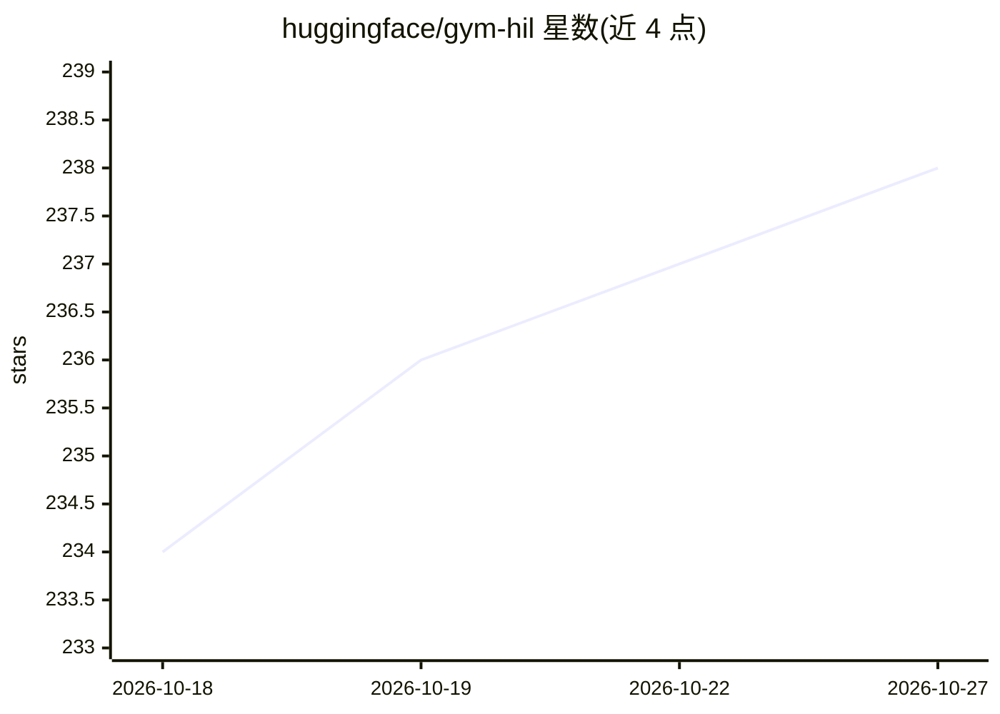

# huggingface/gym-hil

⭐ 238 · Python · Apache-2.0 · 推送 2026-09-24 · [GitHub](https://github.com/huggingface/gym-hil) · 组织维护

**人在回路强化学习的 gymnasium 环境套件，兼容 LeRobot**

提供一组用于 Human-In-the-Loop（HIL）强化学习的 gymnasium 环境：训练期间人类可通过手柄或键盘随时覆盖策略动作，用于采集示教数据与干预式学习。当前包含基于 MuJoCo 的 Franka Panda 机械臂抓取环境（基础版/手柄/键盘三种），并提供 EEActionWrapper、InputsControlWrapper、GripperPenaltyWrapper 等包装器与可自定义的手柄按键映射配置。环境与 Hugging Face 的 LeRobot 代码库集成。通过 PyPI 或源码安装，需 Python 3.10。

## 筛选速览

| 维度 | 判定 | 备注 |
|---|---|---|
| AI 角色 | `ai-ecosystem` | LLM/agent 周边工具 |
| 许可风险 | `permissive` | Apache-2.0 |
| 部署形态 | `library` | 以包/库形式分发 |
| 模型依赖 | — | README 未给出锁定关系 |
| 硬件要求 | — | 无带数字的原话,不猜 |
| 安装摩擦 | `low` | 无编译、无系统依赖或容器化 |
| 成熟度 | — | 结构信号不足 |

## 能力要点

- Franka Panda 机械臂 MuJoCo 抓取环境（基础/手柄/键盘三变体）
- 训练中人类可逐步覆盖策略动作的手柄/键盘干预机制
- HIL 包装器：末端执行器动作空间、输入控制、夹爪惩罚
- 手柄按键映射 JSON 配置可自定义

## 适用场景

- 采集人类示教数据用于机械臂策略训练
- 训练中通过手柄干预纠正策略、提升采样效率与安全性
- 在 LeRobot 中开展人在回路强化学习实验

## 场景标签

`强化学习` · 领域:训练与推理

## 证据(README 行号)

> L3: A collection of gymnasium environments for Human-In-the-Loop (HIL) reinforcement learning, compatible with Hugging F
> L7: The `gym-hil` package provides environments designed for human-in-the-loop reinforcement learning. The list of envir
> L128: All environments in `gym-hil` are designed to work seamlessly with Hugging Face's LeRobot codebase for human-in-th

## 星数曲线

2026-10-18 234 → 2026-10-27 238（+4）

---
*卡片 v1 · prompt 1.4 · 生成 2026-10-22 · 置信度 high · 依据 README sha `bb3142fb0d21` · [字段定义](../../DATASET.md)*
