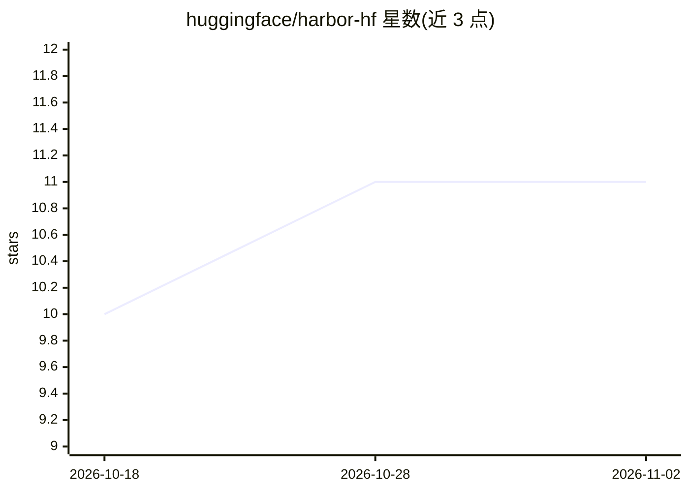

# huggingface/harbor-hf

⭐ 11 · TypeScript · Apache-2.0 · 推送 2026-10-26 · [GitHub](https://github.com/huggingface/harbor-hf) · 组织维护

**在 Hugging Face 基础设施上托管运行 Harbor 基准测试的控制服务**

Harbor-HF 是一个托管控制服务：提交 Harbor 基准测试运行、启动远程父 Job、将结果存入私有 Bucket，并通过 Web 控制台展示运行状态与排行榜。它不在操作者本地执行基准，而是由一个远程父 Job 负责任务解析、重试、恢复与锁管理。控制台支持模型/提供商选择、成本上限、并发试次设置、暂停/恢复/取消及 Agent Workbench 配置流程，另提供 Python CLI 用于提交与检查运行。本地开发需 Python 3.12、uv、Node.js 与 Docker。

## 筛选速览

| 维度 | 判定 | 备注 |
|---|---|---|
| AI 角色 | `ai-ecosystem` | LLM/agent 周边工具 |
| 许可风险 | `permissive` | Apache-2.0 |
| 部署形态 | `None` |  |
| 模型依赖 | — | README 未给出锁定关系 |
| 硬件要求 | — | 无带数字的原话,不猜 |
| 安装摩擦 | `low` | 无编译、无系统依赖或容器化 |
| 成熟度 | — | 结构信号不足 |

## 能力要点

- 远程 Job 执行 Harbor 基准，结果持久化到私有 Bucket
- Web 控制台展示运行状态、排行榜与 Agent Workbench
- CLI 支持提交运行、成本上限机器级限制与配置检查
- 按试次后核算成本并在超限时停止父 Job

## 适用场景

- 团队在 HF 基础设施上可复现地跑 Harbor 基准测试
- 通过排行榜管理 final 与 diagnostic 运行结果
- 用 CLI 批量提交并监控基准运行与 Job 状态

## 场景标签

`模型评测` · 领域:评测与运维

## 证据(README 行号)

> L3: Harbor-HF is a hosted control service for Harbor benchmark runs on Hugging Face.
> L7: Harbor-HF does not run benchmarks on the operator's computer. One remote parent
> L65: Agent Workbench configure, test, and run flow. Workbench compiles one generic

## 星数曲线

2026-10-18 10 → 2026-11-02 11（+1）

---
*卡片 v1 · prompt 1.4 · 生成 2026-11-02 · 置信度 high · 依据 README sha `449ec415d008` · [字段定义](../../DATASET.md)*
