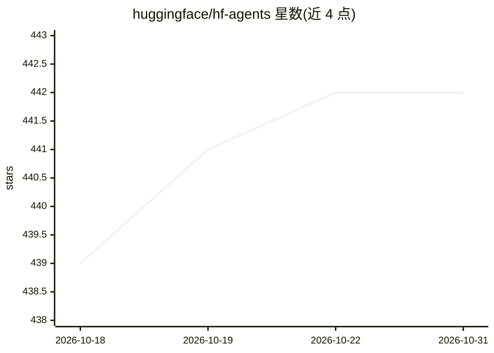

# huggingface/hf-agents

⭐ 442 · Shell · Apache-2.0 · 推送 2026-03-25 · [GitHub](https://github.com/huggingface/hf-agents) · 组织维护

**HF CLI 扩展：检测硬件推荐模型并启动本地编码 agent**

huggingface 官方的 `hf` CLI 扩展：调用 llmfit 检测用户硬件并推荐可运行的模型与量化方案，随后启动本地 llama.cpp 的 llama-server 加载合适模型，并通过 Pi 启动本地编码 agent，一条命令完成从硬件检测到 agent 运行。支持交互式选模型与非交互模式，已在运行的 llama-server 会被复用并跳过选模型。依赖 hf CLI、llmfit、llama.cpp、Pi 及 jq/fzf/curl。

## 筛选速览

| 维度 | 判定 | 备注 |
|---|---|---|
| AI 角色 | `ai-ecosystem` | LLM/agent 周边工具 |
| 许可风险 | `permissive` | Apache-2.0 |
| 部署形态 | `None` |  |
| 模型依赖 | — | README 未给出锁定关系 |
| 硬件要求 | — | 无带数字的原话,不猜 |
| 安装摩擦 | `low` | 无编译、无系统依赖或容器化 |
| 成熟度 | — | 结构信号不足 |

## 能力要点

- 硬件检测与模型/量化推荐（llmfit 透传，支持其全部子命令）
- 一条命令启动 llama-server 并拉起 Pi 编码 agent
- 复用已在目标端口运行的 llama-server
- 通过环境变量配置端口与 HF_TOKEN 下载 gated 模型

## 适用场景

- 我不确定本机能跑什么模型，想快速得到推荐
- 想在本地一键跑起一个编码 agent
- 按用途（如 coding）筛选适配本机的模型

## 场景标签

`编码 Agent` · 领域:编码与开发

## 证据(README 行号)

> L1: # hf-agents : `hf` CLI extension to detect the best model/quant for a user's hardware and then spins up a local codi
> L3: hf-agents is a HF CLI extension that uses llmfit to detect the user's hardware and recommend models they can actuall

## 星数曲线

2026-10-18 439 → 2026-10-31 442（+3）

---
*卡片 v1 · prompt 1.4 · 生成 2026-10-21 · 置信度 high · 依据 README sha `d92d13bf5d3c` · [字段定义](../../DATASET.md)*
