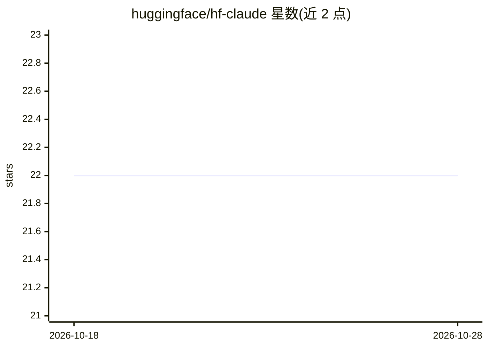

# huggingface/hf-claude

⭐ 22 · Shell · 推送 2026-08-13 · [GitHub](https://github.com/huggingface/hf-claude) · 组织维护

**hf CLI 扩展：通过 HF Inference Providers 启动 Claude Code**

为 Hugging Face 官方 CLI（hf）提供的扩展，交互式选择模型与推理提供方（auto 或具体 provider），随后以预设环境变量运行 claude --model <model[:provider]>。依赖 Claude Code CLI、curl/jq/bash，fzf 可选（缺失时回退为方向键菜单）。需 HF token 登录。支持 --bill-to 将推理用量计费到组织（通过 X-HF-Bill-To 头）。仅面向已安装 Claude Code CLI 的命令行用户。

## 筛选速览

| 维度 | 判定 | 备注 |
|---|---|---|
| AI 角色 | `ai-ecosystem` | LLM/agent 周边工具 |
| 许可风险 | `none` | — |
| 部署形态 | `None` |  |
| 模型依赖 | — | README 未给出锁定关系 |
| 硬件要求 | — | 无带数字的原话,不猜 |
| 安装摩擦 | `low` | 无编译、无系统依赖或容器化 |
| 成熟度 | — | 结构信号不足 |

## 能力要点

- 从 router.huggingface.co 模型列表中选择模型与 provider
- 自动预配置环境变量后运行 claude 命令
- fzf 模糊搜索，缺失时回退方向键菜单
- --bill-to 组织计费（X-HF-Bill-To 头）

## 适用场景

- 用 HF Inference Providers 的模型运行 Claude Code
- 把 Claude Code 推理用量计费到 HF 组织账户
- 在 CLI 里模糊搜索并切换模型/provider

## 场景标签

`编码 Agent` · 领域:编码与开发

## 证据(README 行号)

> L3: extension for `hf` to launch Claude Code with Hugging Face Inference Providers
> L9: Then it runs `claude --model <model[:provider]>` with the required env vars preconfigured.

## 星数曲线

2026-10-18 22 → 2026-10-28 22（+0）

---
*卡片 v1 · prompt 1.4 · 生成 2026-10-27 · 置信度 high · 依据 README sha `400ef4e04b86` · [字段定义](../../DATASET.md)*
