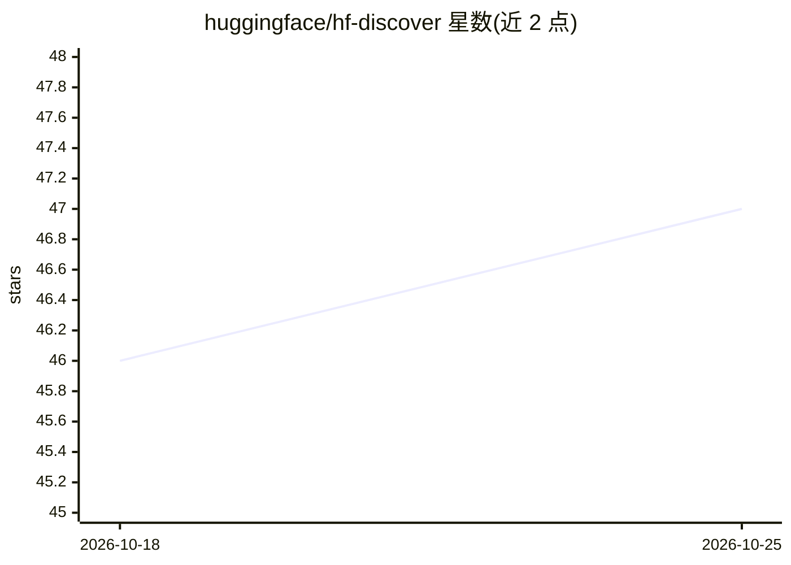

# huggingface/hf-discover

⭐ 47 · Python · MIT · 推送 2026-09-29 · [GitHub](https://github.com/huggingface/hf-discover) · 组织维护

**面向 agent 的资源发现客户端/服务器：检索技能与 MCP Server 目录**

实现 ARD（Agent Resource Discovery）规范的客户端与服务器。CLI 通过 `hf discover` 命令搜索或导航任意 ARD 兼容注册表；服务器将 Hugging Face Spaces 语义搜索与 skills 索引合并为 ARD 目录条目，可生成 Space 的 skill 产物与 MCP server 卡片，仅返回运行状态为 RUNNING 的 Spaces。客户端导航模式通过 `.well-known/ai-catalog.json` 发现并跟随联邦注册表，做来源均衡的结果合并。另附本地挑战注册表（challenge registry）用于客户端开发测试，遵循 ARD v0.5 规范（含字段路径过滤、federation referrals），通过 PyPI 发布并由 GitHub Actions 自动发布。

## 筛选速览

| 维度 | 判定 | 备注 |
|---|---|---|
| AI 角色 | `ai-ecosystem` | LLM/agent 周边工具 |
| 许可风险 | `permissive` | MIT |
| 部署形态 | `library` | 以包/库形式分发 |
| 模型依赖 | — | README 未给出锁定关系 |
| 硬件要求 | — | 无带数字的原话,不猜 |
| 安装摩擦 | `low` | 无编译、无系统依赖或容器化 |
| 成熟度 | — | 结构信号不足 |

## 能力要点

- CLI 搜索/导航任意 ARD 兼容注册表，支持联邦注册表跟随与深度控制
- 服务器将 Hugging Face Spaces 语义搜索暴露为 ARD 目录，生成 skill 与 MCP server 卡片条目
- 仅返回 runtime stage 为 RUNNING 的 Spaces，状态暴露在结果元数据中
- 内置本地确定性挑战注册表，覆盖 skills、MCP servers、A2A agents、嵌套注册表等混合结果类型

## 适用场景

- 用 CLI 或 REST API/MCP 工具为 agent 查找可用的技能与 MCP Server
- 从某网站出发发现联邦 AI 目录并做来源均衡的跨注册表检索
- 在本地用挑战注册表测试 ARD 客户端的注册表树遍历能力

## 场景标签

 · 领域:AI agent 基础设施/资源发现

## 证据(README 行号)

> L3: An Agent Resource Discovery (ARDs) compliant Client and Server.
> L17: The Server provides semantic search to thousands of Skills and MCP Servers to connect to your agent.
> L56: `hf-discover` exposes Hugging Face Spaces semantic search in the primary `/search` endpoint

## 星数曲线

2026-10-18 46 → 2026-10-25 47（+1）

---
*卡片 v1 · prompt 1.4 · 生成 2026-10-25 · 置信度 high · 依据 README sha `9ea6d0a47a32` · [字段定义](../../DATASET.md)*
