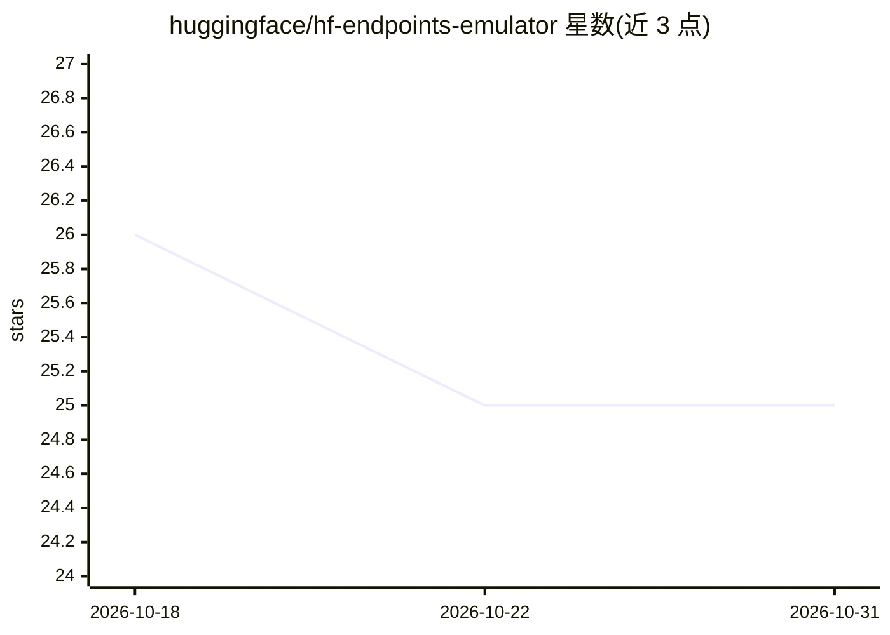

# huggingface/hf-endpoints-emulator

⭐ 25 · Python · MIT · 推送 2026-09-23 · [GitHub](https://github.com/huggingface/hf-endpoints-emulator) · 组织维护

**本地模拟 Hugging Face Inference Endpoints 自定义 handler 的测试工具**

hf-endpoints-emulator 由 Hugging Face 团队维护，提供命令行工具 hf-endpoints-emulator 与 hf_endpoint_emulator Python 包两种形式，用于在本地运行和调试 Inference Endpoints 的自定义 handler（如 speaker diarization、diffusion 等 Transformers 暂不支持的任务），在部署到 Inference Endpoints 之前进行测试。本地启动 web 服务器（默认 localhost:5000），可通过 curl 或 Python requests 发送请求验证。通过 pip 安装，examples/ 目录附带使用示例。

## 筛选速览

| 维度 | 判定 | 备注 |
|---|---|---|
| AI 角色 | `ai-ecosystem` | LLM/agent 周边工具 |
| 许可风险 | `permissive` | MIT |
| 部署形态 | `library` | 以包/库形式分发 |
| 模型依赖 | — | README 未给出锁定关系 |
| 硬件要求 | — | 无带数字的原话,不猜 |
| 安装摩擦 | `low` | 无编译、无系统依赖或容器化 |
| 成熟度 | — | 结构信号不足 |

## 能力要点

- 命令行与 Python 包两种方式在本地运行自定义 handler
- 启动本地 web 服务器（localhost:5000）接收请求测试
- 支持调试 Inference Endpoints 的自定义任务 handler

## 适用场景

- 在部署到 Inference Endpoints 前本地验证自定义 handler
- 调试自定义任务（如 speaker diarization、diffusion）的 handler 逻辑
- 在本地通过 curl/Python 请求模拟推理端点调用

## 场景标签

 · 领域:MLOps/模型部署测试

## 证据(README 行号)

> L7: The `hf-endpoints-emulator` package provides a simple way to test your custom handlers locally before deploying them
> L9: The package provides a `hf-endpoints-emulator` command line tool that can be used to run your custom handlers locall

## 星数曲线

2026-10-18 26 → 2026-10-31 25（-1）

---
*卡片 v1 · prompt 1.4 · 生成 2026-10-27 · 置信度 high · 依据 README sha `9c4762dd6549` · [字段定义](../../DATASET.md)*
