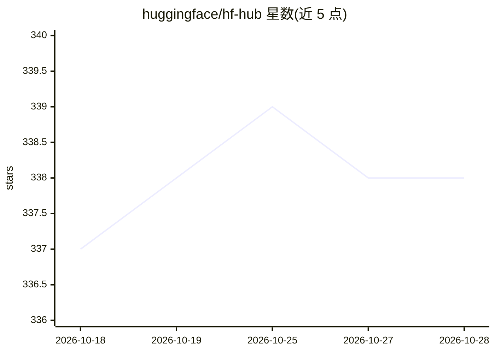

# huggingface/hf-hub

⭐ 338 · Rust · Apache-2.0 · 推送 2026-10-27 · [GitHub](https://github.com/huggingface/hf-hub) · 组织维护

**面向 Rust 开发者的 Hugging Face Hub API 客户端库**

提供类型化的 Rust 接口与 Hugging Face Hub 交互，功能覆盖仓库元数据查询与增删改、文件上传下载、commit 与分支标签管理、用户组织信息、bucket 操作及 Xet 存储后端传输。同时提供异步（HFClient）与同步（HFClientSync）两套镜像 API，异步列表端点返回 Stream 实现惰性分页。附带 hfrs 命令行工具，可编译到 wasm32 目标（仅流式下载路径）。库本身不读环境变量，token、endpoint 与缓存路径需通过 builder 显式配置。

## 筛选速览

| 维度 | 判定 | 备注 |
|---|---|---|
| AI 角色 | `ai-ecosystem` | LLM/agent 周边工具 |
| 许可风险 | `permissive` | Apache-2.0 |
| 部署形态 | `library` | 以包/库形式分发 |
| 模型依赖 | — | README 未给出锁定关系 |
| 硬件要求 | — | 无带数字的原话,不猜 |
| 安装摩擦 | `low` | 无编译、无系统依赖或容器化 |
| 成熟度 | — | 结构信号不足 |

## 能力要点

- 仓库/文件/commit/分支标签等 Hub 全量操作的类型化接口
- 异步与同步双 API，流式分页惰性迭代
- 支持 Xet 高性能传输后端与 bucket 操作
- 可编译到 wasm32（仅 HTTP/流式下载子集）

## 适用场景

- 在 Rust 项目中下载或上传 Hugging Face Hub 模型与数据集文件
- 程序化管理仓库、分支、标签与 commit
- 通过 hfrs CLI 在终端操作 Hub

## 场景标签

 · 领域:AI 基础设施/开发者工具

## 证据(README 行号)

> L3: Rust client for the Hugging Face Hub API.
> L5: `hf-hub` provides a typed, ergonomic interface for interacting with the Hugging Face Hub from Rust. It is the Rust e

## 星数曲线

2026-10-18 337 → 2026-10-28 338（+1）

---
*卡片 v1 · prompt 1.4 · 生成 2026-10-21 · 置信度 high · 依据 README sha `ba4b81ced8dc` · [字段定义](../../DATASET.md)*
