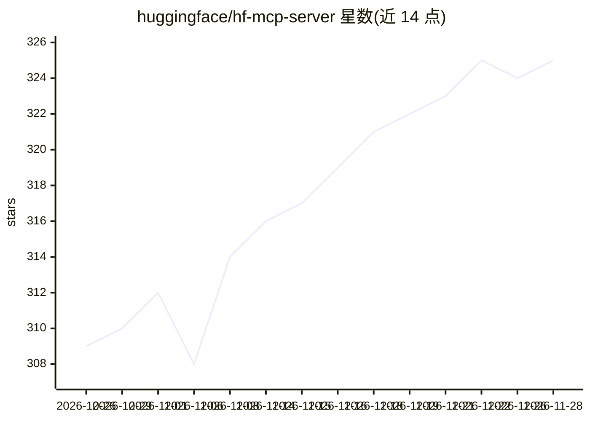

# huggingface/hf-mcp-server

⭐ 325 · TypeScript · MIT · 推送 2026-11-27 · [GitHub](https://github.com/huggingface/hf-mcp-server) · [官网](https://huggingface.co/mcp) · 组织维护

**将 LLM 客户端接入 Hugging Face Hub 与 Gradio 应用的官方 MCP 服务器**

Hugging Face 官方 MCP Server，让 Claude Desktop/Code、Gemini CLI、VSCode、Cursor 等 MCP 客户端连接 Hugging Face Hub 与数千个 Gradio 应用。提供 Hub API 与搜索端点的 MCP 实现，支持 STDIO 与 StreamableHTTP 两种传输，可按 bouquet 配置工具集（含 53 个类型化函数的 PTC 工具集），带管理 Web 界面展示指标与 Skills 活动。可通过 npx 或 docker 本地运行，官方托管端点为 https://huggingface.co/mcp，写操作需 HF token 认证。

## 筛选速览

| 维度 | 判定 | 备注 |
|---|---|---|
| AI 角色 | `ai-ecosystem` | LLM/agent 周边工具 |
| 许可风险 | `permissive` | MIT |
| 部署形态 | `self-host` | docker 或自建部署 |
| 模型依赖 | — | README 未给出锁定关系 |
| 硬件要求 | — | 无带数字的原话,不猜 |
| 安装摩擦 | `low` | 无编译、无系统依赖或容器化 |
| 成熟度 | — | 结构信号不足 |

## 能力要点

- 支持 STDIO 与 StreamableHTTP（无状态 JSON 模式）两种传输
- bouquet 工具集配置：openai 与 PTC（53 个类型化函数，hf:// URI 关联）
- 管理 Web 界面（/metrics）提供服务器状态、方法指标与 Skills 活动看板
- npx 与 docker 两种本地运行方式，默认端口 3000

## 适用场景

- 让 Claude Code 或 Cursor 等客户端搜索和操作 Hugging Face Hub 仓库
- 在 MCP 客户端中调用 Hugging Face Spaces 与沙箱工具
- 本地部署 MCP 服务器并按 token 权限控制可用工具

## 场景标签

 · 领域:LLM 基础设施/MCP

## 证据(README 行号)

> L1: # Hugging Face Official MCP Server
> L3: Welcome to the official Hugging Face MCP Server 🤗. Connect your LLM to the Hugging Face Hub and thousands of Gradio 
> L80:  - (`/mcp`) MCP Implementations of Hub API and Search endpoints for integration with MCP Servers.

## 星数曲线

2026-10-26 309 → 2026-11-28 325（+16）

---
*卡片 v1 · prompt 1.4 · 生成 2026-11-28 · 置信度 high · 依据 README sha `39e290d2a716` · [字段定义](../../DATASET.md)*
