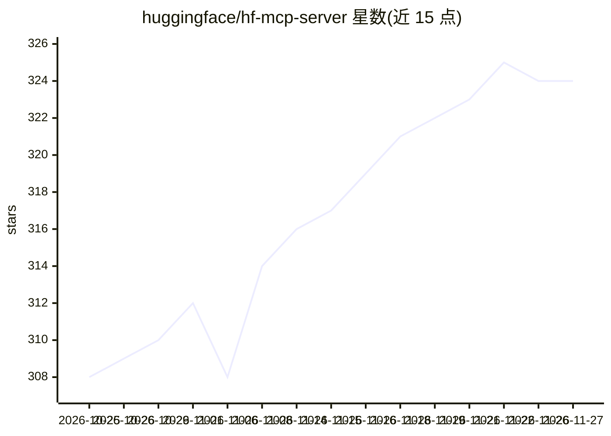

# huggingface/hf-mcp-server

⭐ 324 · TypeScript · MIT · 推送 2026-11-25 · [GitHub](https://github.com/huggingface/hf-mcp-server) · [官网](https://huggingface.co/mcp) · 组织维护

**将 LLM 客户端接入 Hugging Face Hub 与 Gradio 应用的 MCP 服务器**

Hugging Face 官方 MCP 服务器，把 Hub API、仓库搜索与数千个 Gradio 应用暴露为 MCP 工具，供 Claude Desktop、Claude Code、Gemini CLI、VSCode、Cursor 等 MCP 客户端接入。支持 STDIO 与 Stateless StreamableHTTP JSON 两种传输，提供远程托管端点与本地 npx/docker 部署；工具集可通过 bouquet 参数切换（如 openai 工具集与 53 个类型化函数的 PTC 工具集），并带 /metrics 管理界面、Skills 活动看板与环境变量配置。

## 筛选速览

| 维度 | 判定 | 备注 |
|---|---|---|
| AI 角色 | `ai-ecosystem` | LLM/agent 周边工具 |
| 许可风险 | `permissive` | MIT |
| 部署形态 | `self-host` | docker 或自建部署 |
| 模型依赖 | — | README 未给出锁定关系 |
| 硬件要求 | — | 无带数字的原话,不猜 |
| 安装摩擦 | `low` | 无编译、无系统依赖或容器化 |
| 成熟度 | — | 结构信号不足 |

## 能力要点

- 支持 STDIO 与 StreamableHTTP(JSON) 两种传输，提供远程端点与本地部署
- bouquet=openai 暴露 Hub 文件系统、搜索、Space、Jobs、sandbox 工具；bouquet=ptc 提供 53 个类型化函数
- /metrics 管理界面报告服务器状态、MCP 方法指标与 Skills 活动
- 提供 npx、Docker 镜像与源码构建三种运行方式

## 适用场景

- 让 Claude Desktop/Claude Code 搜索和读取 Hugging Face Hub 仓库与数据集
- 通过 MCP 调用 Hub 上的 Gradio Space 工具
- 自托管 MCP 服务器并按环境变量配置工具暴露范围

## 场景标签

 · 领域:LLM 基础设施/MCP 工具集成

## 证据(README 行号)

> L3: Welcome to the official Hugging Face MCP Server 🤗. Connect your LLM to the Hugging Face Hub and thousands of Gradio 
> L80:  - (`/mcp`) MCP Implementations of Hub API and Search endpoints for integration with MCP Servers.
> L85: The following transports are supported:

## 星数曲线

2026-10-25 308 → 2026-11-27 324（+16）

---
*卡片 v1 · prompt 1.4 · 生成 2026-11-26 · 置信度 high · 依据 README sha `bfd6ebef0427` · [字段定义](../../DATASET.md)*
