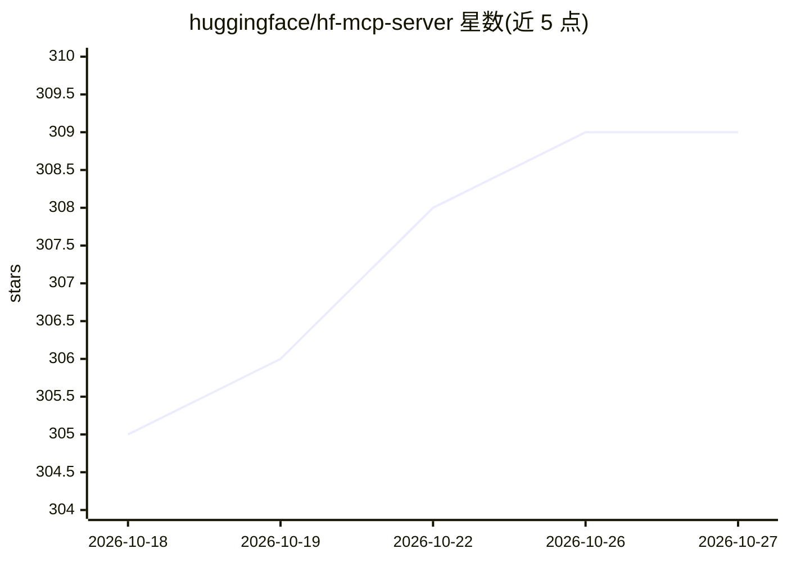

# huggingface/hf-mcp-server

⭐ 309 · TypeScript · MIT · 推送 2026-10-24 · [GitHub](https://github.com/huggingface/hf-mcp-server) · [官网](https://huggingface.co/mcp) · 组织维护

**Hugging Face 官方 MCP 服务器：把 LLM 接入 Hub 与 Gradio 应用**

由 Hugging Face 维护的官方 MCP Server，将 Claude、Gemini CLI、VSCode、Cursor 等客户端通过 MCP 协议接入 Hugging Face Hub 与数千个 Gradio AI 应用，暴露 Hub API、仓库搜索/创建、Spaces、Jobs 等工具。支持 STDIO 与 StreamableHTTP JSON 两种传输，可通过 npx 或 Docker 本地运行，默认端口 3000，附带 /metrics 状态页、Skills 活动监控与大量环境变量配置（令牌校验、主机白名单、工具禁用等）。

## 筛选速览

| 维度 | 判定 | 备注 |
|---|---|---|
| AI 角色 | `ai-ecosystem` | LLM/agent 周边工具 |
| 许可风险 | `permissive` | MIT |
| 部署形态 | `self-host` | docker 或自建部署 |
| 模型依赖 | — | README 未给出锁定关系 |
| 硬件要求 | — | 无带数字的原话,不猜 |
| 安装摩擦 | `low` | 无编译、无系统依赖或容器化 |
| 成熟度 | — | 结构信号不足 |

## 能力要点

- MCP 实现覆盖 Hub API、仓库搜索/创建、Spaces、Jobs 与沙箱工具
- 支持 STDIO 与 StreamableHTTP JSON 两种传输，npx/Docker 本地运行
- Management Web 界面提供服务器状态、MCP 方法指标与 Skills 活动监控
- 通过环境变量配置令牌校验、主机白名单、工具禁用等

## 适用场景

- 在 Claude/Gemini CLI/Cursor/VSCode 中直接搜索和操作 Hugging Face 仓库
- 让 LLM 调用 Hub 上的 Gradio AI 应用作为工具
- 自托管部署带指标监控的 MCP 服务端

## 场景标签

 · 领域:LLM 基础设施/MCP 工具服务

## 证据(README 行号)

> L3: Welcome to the official Hugging Face MCP Server 🤗. Connect your LLM to the Hugging Face Hub and thousands of Gradio 
> L80:  - (`/mcp`) MCP Implementations of Hub API and Search endpoints for integration with MCP Servers.

## 星数曲线

2026-10-18 305 → 2026-10-27 309（+4）

---
*卡片 v1 · prompt 1.4 · 生成 2026-10-21 · 置信度 high · 依据 README sha `899a019d05e6` · [字段定义](../../DATASET.md)*
