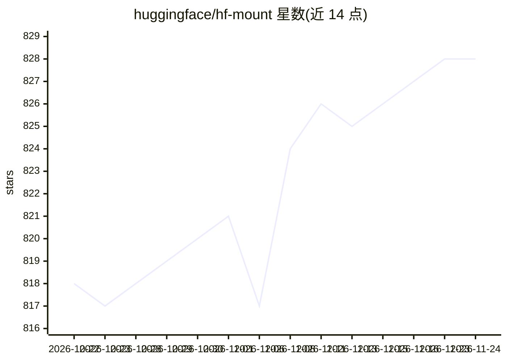

# huggingface/hf-mount

⭐ 828 · Rust · Apache-2.0 · 推送 2026-11-17 · [GitHub](https://github.com/huggingface/hf-mount) · 组织维护

**把 Hugging Face 仓库挂载为本地文件系统，按需读取不下载**

用 Rust 编写的 CLI 工具，通过 NFS 或 FUSE 后端将 Hugging Face Buckets 与 Hub 模型/数据集仓库挂载为本地目录，文件在首次读取时按需从网络拉取。支持公共仓库只读挂载与带 token 的私有仓库读写，Bucket 提供 --advanced-writes 随机写与异步 flush。NFS 后端无需 root 与系统依赖；FUSE 需 fuse3 或 macFUSE。提供 brew 安装、GitHub Releases 二进制与源码构建。限制：首读有网络往返、元数据可滞后最长 10 秒、多挂载并发写不检测冲突。

## 筛选速览

| 维度 | 判定 | 备注 |
|---|---|---|
| AI 角色 | `ai-ecosystem` | LLM/agent 周边工具 |
| 许可风险 | `permissive` | Apache-2.0 |
| 部署形态 | `desktop` | 安装包/桌面程序 |
| 模型依赖 | — | README 未给出锁定关系 |
| 硬件要求 | — | 无带数字的原话,不猜 |
| 安装摩擦 | `medium` | 含编译或系统依赖之一 |
| 成熟度 | — | 结构信号不足 |

## 能力要点

- NFS/FUSE 双后端，NFS 无需 root 与系统依赖
- 按需懒加载，仅读取实际触碰的字节
- Bucket 支持 SSE live-follow 与轮询两种远程变更感知方式
- 提供 chunk/file 两种磁盘缓存模式（默认约 10 GB）

## 适用场景

- 训练或推理时直接加载模型文件而不下载整个仓库
- 用 ls/cat/grep 浏览仓库内容而无需 clone
- 磁盘空间受限的环境里读取大型数据集
- 将训练 checkpoint、日志写入 Hub Bucket 存储

## 场景标签

 · 领域:机器学习基础设施/存储

## 证据(README 行号)

> L5: Mount Hugging Face Buckets and repos as local filesystems. No download, no copy, no waiting.
> L25: hf-mount exposes Hugging Face Buckets and Hub repos as a local filesystem via FUSE or NFS. Files are fetched lazily
> L97: - Read-heavy ML workloads (training, inference, evaluation)

## 星数曲线

2026-10-22 818 → 2026-11-24 828（+10）

---
*卡片 v1 · prompt 1.4 · 生成 2026-11-24 · 置信度 high · 依据 README sha `d2e89e7eef29` · [字段定义](../../DATASET.md)*
