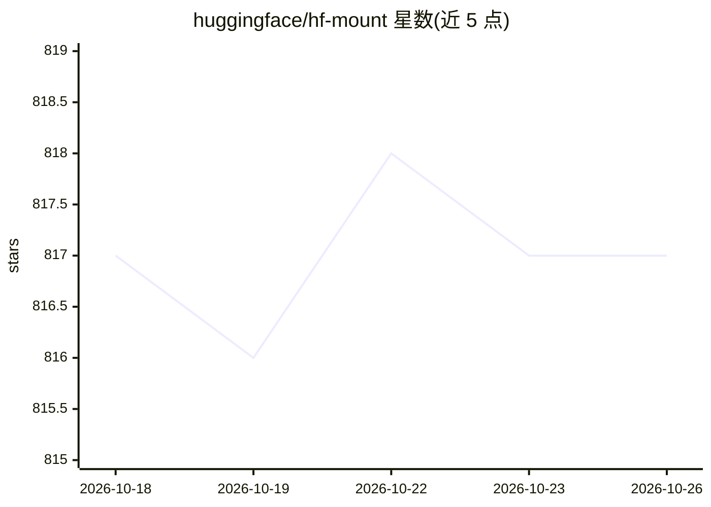

# huggingface/hf-mount

⭐ 817 · Rust · Apache-2.0 · 推送 2026-10-18 · [GitHub](https://github.com/huggingface/hf-mount) · 组织维护

**把 Hugging Face 仓库与 Bucket 挂载为本地文件系统的工具**

由 Hugging Face 维护的 Rust 命令行工具：通过 NFS 或 FUSE 后端把 Hub 上的模型/数据集仓库（只读）和 Bucket（可读写，S3 式对象存储）挂载为本地目录，文件按需惰性拉取，只传输代码实际读取的字节，无需预先下载整个仓库。NFS 后端无系统依赖、无需 root；FUSE 后端需 fuse3 或 macFUSE。提供 Homebrew 安装、GitHub Releases 预编译二进制与 cargo 源码构建。README 明确列出适用与不适用场景（不支持多写者、跨节点锁，元数据最长 10 秒延迟）。

## 筛选速览

| 维度 | 判定 | 备注 |
|---|---|---|
| AI 角色 | `ai-ecosystem` | LLM/agent 周边工具 |
| 许可风险 | `permissive` | Apache-2.0 |
| 部署形态 | `library` | 以包/库形式分发 |
| 模型依赖 | — | README 未给出锁定关系 |
| 硬件要求 | — | 无带数字的原话,不猜 |
| 安装摩擦 | `medium` | 含编译或系统依赖之一 |
| 成熟度 | — | 结构信号不足 |

## 能力要点

- NFS 与 FUSE 双后端，文件惰性拉取、按需读取
- 仓库只读挂载、Bucket 读写挂载（含 staging 异步写入与 overlay 模式）
- chunk/file 两种本地磁盘缓存层，默认约 10GB 上限
- Homebrew、预编译二进制（Linux x86_64/aarch64、macOS Apple Silicon）与源码构建三种安装途径

## 适用场景

- 磁盘空间有限时直接加载模型和数据集而不完整下载
- 用 ls/cat/find/grep 浏览仓库内容而无需 clone
- 训练、推理、评测等读密集型 ML 工作负载
- Agent 通过本地文件系统直接访问 Hub 数据

## 场景标签

 · 领域:ML 基础设施/存储

## 证据(README 行号)

> L25: hf-mount exposes Hugging Face Buckets and Hub repos as a local filesystem via FUSE or NFS. Files are fetched lazily
> L81: - Read-heavy ML workloads (training, inference, evaluation)

## 星数曲线

2026-10-18 817 → 2026-10-26 817（+0）

---
*卡片 v1 · prompt 1.4 · 生成 2026-10-21 · 置信度 high · 依据 README sha `48732dc23650` · [字段定义](../../DATASET.md)*
