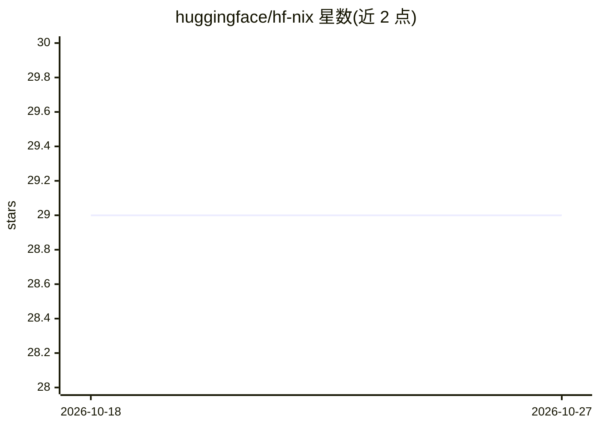

# huggingface/hf-nix

⭐ 29 · Nix · 推送 2026-10-14 · [GitHub](https://github.com/huggingface/hf-nix) · 组织维护

**Hugging Face 内部 Nix 软件包集合与二进制缓存 flake**

Hugging Face 维护的 Nix flake，收录其内部使用、nixpkgs 中缺失或需要不同版本的软件包。以 Nix overlay（overlays.default）形式供外部使用，并配套二进制缓存：将 nixpkgs input 指向本 flake 后，可通过 Cachix 启用 Hugging Face Nix cache 获取预构建产物，避免本地编译。面向使用 Nix 的开发者。

## 筛选速览

| 维度 | 判定 | 备注 |
|---|---|---|
| AI 角色 | `ai-ecosystem` | LLM/agent 周边工具 |
| 许可风险 | `none` | — |
| 部署形态 | `None` |  |
| 模型依赖 | — | README 未给出锁定关系 |
| 硬件要求 | — | 无带数字的原话,不猜 |
| 安装摩擦 | `low` | 无编译、无系统依赖或容器化 |
| 成熟度 | — | 结构信号不足 |

## 能力要点

- 以 overlay（overlays.default）形式提供 nixpkgs 之外的软件包
- 配套二进制缓存，通过 Cachix 获取预构建产物
- 收录 nixpkgs 缺失或需不同版本/构建的包

## 适用场景

- 在 Nix 环境中获取 Hugging Face 使用的软件包
- 通过二进制缓存避免本地编译开销
- 为 nixpkgs 之外的包提供统一版本管理

## 场景标签

 · 领域:软件打包/开发基础设施

## 证据(README 行号)

> L3: This Nix flake contains packages that are used within Hugging Face. These
> L7: The flake is normally used as an overlay (`overlays.default`).

## 星数曲线

2026-10-18 29 → 2026-10-27 29（+0）

---
*卡片 v1 · prompt 1.4 · 生成 2026-10-26 · 置信度 mid · 依据 README sha `8be5dc25c3c8` · [字段定义](../../DATASET.md)*
