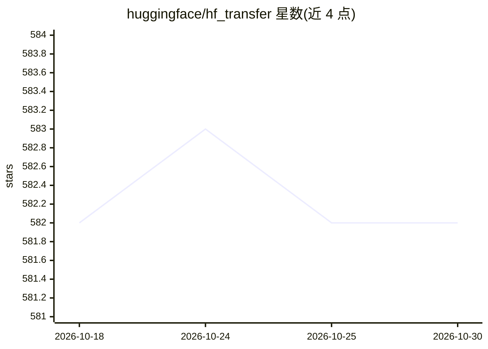

# huggingface/hf_transfer

⭐ 582 · Rust · Apache-2.0 · 推送 2026-09-29 · [GitHub](https://github.com/huggingface/hf_transfer) · 组织维护

**加速 Hugging Face Hub 文件传输的 Rust 库，突破 Python 带宽瓶颈**

面向高级用户的文件传输加速库，配合 huggingface_hub 在极高带宽网络（约 500MB/s 以上）下提升与 Hub 的传输速度，弥补 Python 无法跑满带宽的限制。有意不提供进度条，以原样交付；README 声明它不是通用易用性工具，仅当下载文件本身有问题时才应提交 issue。由 Hugging Face 团队维护，作为 huggingface_hub 的配套组件使用。

## 筛选速览

| 维度 | 判定 | 备注 |
|---|---|---|
| AI 角色 | `ai-ecosystem` | LLM/agent 周边工具 |
| 许可风险 | `permissive` | Apache-2.0 |
| 部署形态 | `library` | 以包/库形式分发 |
| 模型依赖 | — | README 未给出锁定关系 |
| 硬件要求 | — | 无带数字的原话,不猜 |
| 安装摩擦 | `low` | 无编译、无系统依赖或容器化 |
| 成熟度 | — | 结构信号不足 |

## 能力要点

- 在极高带宽网络下超越约 500MB/s 的传输瓶颈
- 作为 huggingface_hub 的提速组件使用
- 以 Rust 实现，明确声明为 power user 工具

## 适用场景

- 高带宽服务器上快速下载/上传 Hub 上的大模型权重与数据集
- 批量同步模型仓库时减少传输耗时

## 场景标签

 · 领域:AI 基础设施/文件传输

## 证据(README 行号)

> L3: Speed up file transfers with the Hub.
> L7: This library is a power user tool, to go beyond `~500MB/s` on very high bandwidth

## 星数曲线

2026-10-18 582 → 2026-10-30 582（+0）

---
*卡片 v1 · prompt 1.4 · 生成 2026-10-21 · 置信度 low · 依据 README sha `4ce848f2a255` · [字段定义](../../DATASET.md)*
