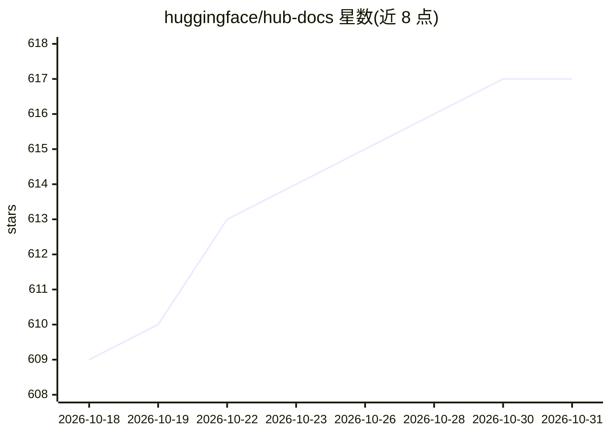

# huggingface/hub-docs

⭐ 617 · Handlebars · Apache-2.0 · 推送 2026-10-30 · [GitHub](https://github.com/huggingface/hub-docs) · [官网](http://hf.co/docs/hub) · 组织维护

**Hugging Face Hub 官方文档仓库，供社区协作编写**

存放 Hugging Face 网站所托管文档的仓库，核心内容在 docs 目录下对应 hf.co/docs/hub。文档以 Markdown 编写，贡献流程为编辑后提交 PR，由 CI 机器人构建预览页面。本地预览需通过 pip 安装 hf-doc-builder；简单编辑无需本地构建环境。README 同时列出相关组件仓库链接：Hub 交互工具库、Hub Inference 与 Hub Tasks。面向文档贡献者与 Hugging Face 平台用户。

## 筛选速览

| 维度 | 判定 | 备注 |
|---|---|---|
| AI 角色 | `ai-knowledge` | 知识聚合/清单类 |
| 许可风险 | `permissive` | Apache-2.0 |
| 部署形态 | `library` | 以包/库形式分发 |
| 模型依赖 | — | README 未给出锁定关系 |
| 硬件要求 | — | 无带数字的原话,不猜 |
| 安装摩擦 | `low` | 无编译、无系统依赖或容器化 |
| 成熟度 | — | 结构信号不足 |

## 能力要点

- docs 目录对应 hf.co/docs/hub 的文档源文件
- Markdown 编辑 + PR + CI 机器人构建预览的贡献流程
- pip 安装 hf-doc-builder 支持本地预览

## 适用场景

- 查阅或修正 Hugging Face Hub 的官方文档
- 通过 PR 参与文档共建并获取自动预览链接

## 场景标签

 · 领域:AI 平台文档

## 证据(README 行号)

> L3: This repository regroups documentation and information that is hosted on the Hugging Face website.
> L5: You can access the Hugging Face Hub documentation in the `docs` folder at hf.co/docs/hub.

## 星数曲线

2026-10-18 609 → 2026-10-31 617（+8）

---
*卡片 v1 · prompt 1.4 · 生成 2026-10-21 · 置信度 high · 依据 README sha `1ed56bbf7003` · [字段定义](../../DATASET.md)*
