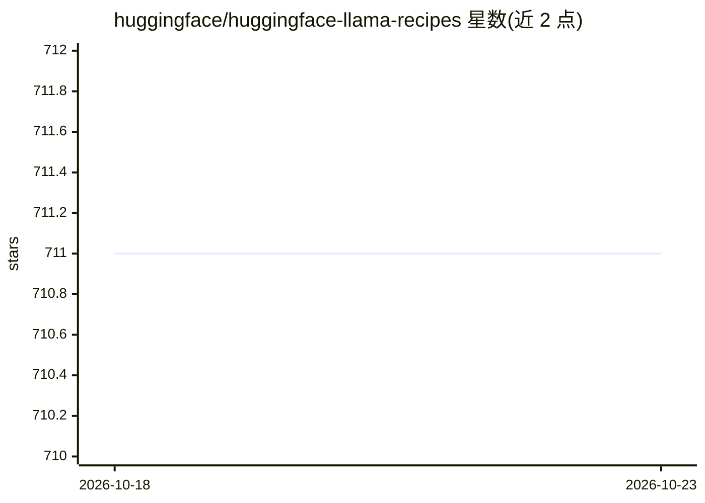

# huggingface/huggingface-llama-recipes

⭐ 711 · Jupyter Notebook · 推送 2026-08-24 · [GitHub](https://github.com/huggingface/huggingface-llama-recipes) · 组织维护

**Hugging Face 官方 Llama 3.x 模型上手示例与教程合集**

由 Hugging Face 维护的 Llama 3.1/3.2/3.3 模型最小化上手配方仓库：覆盖本地推理（含各模型规模在不同精度下的显存估算表）、bitsandbytes/AWQ/GPTQ 量化、PEFT/QLoRA 微调、SLURM 集群分布式微调、投机解码、torch.compile 与 KV Cache 量化等性能优化，以及 Llama Guard/Prompt Guard 安全模型、合成数据生成、RAG、TGI 部署、聊天机器人与工具调用等 notebook。使用模型需先接受许可并申请访问权限；仓库标注为 WIP 状态。面向使用 transformers 生态运行 Llama 的开发与科研用户。

## 筛选速览

| 维度 | 判定 | 备注 |
|---|---|---|
| AI 角色 | `ai-knowledge` | 知识聚合/清单类 |
| 许可风险 | `none` | — |
| 部署形态 | `library` | 以包/库形式分发 |
| 模型依赖 | — | README 未给出锁定关系 |
| 硬件要求 | — | 无带数字的原话,不猜 |
| 安装摩擦 | `low` | 无编译、无系统依赖或容器化 |
| 成熟度 | `idea` | |

## 能力要点

- 覆盖推理/量化/微调/投机解码/性能优化的 notebook 配方
- 按模型规模与精度（BF16/FP8/INT4）的显存需求估算表
- Llama Guard 与 Prompt Guard 安全模型使用示例
- RAG、TGI 部署、聊天机器人、工具调用等端到端示例

## 适用场景

- 快速上手用 transformers 运行 Llama 3.x 模型
- 在消费级 GPU 上用 QLoRA 微调 Llama
- 为 LLM 工作流接入 Llama Guard 做输入输出安全分类
- 用小模型为大模型做投机解码加速生成

## 场景标签

`教程课程` `微调` `模型量化` · 领域:学习与行业

## 证据(README 行号)

> L5: 🤗🦙Welcome! This repository contains *minimal* recipes to get started quickly
> L12: This repository is WIP so that you might see considerable changes in the coming days.

## 星数曲线

2026-10-18 711 → 2026-10-23 711（+0）

---
*卡片 v1 · prompt 1.4 · 生成 2026-10-21 · 置信度 mid · 依据 README sha `6b65ee3f90d2` · [字段定义](../../DATASET.md)*
