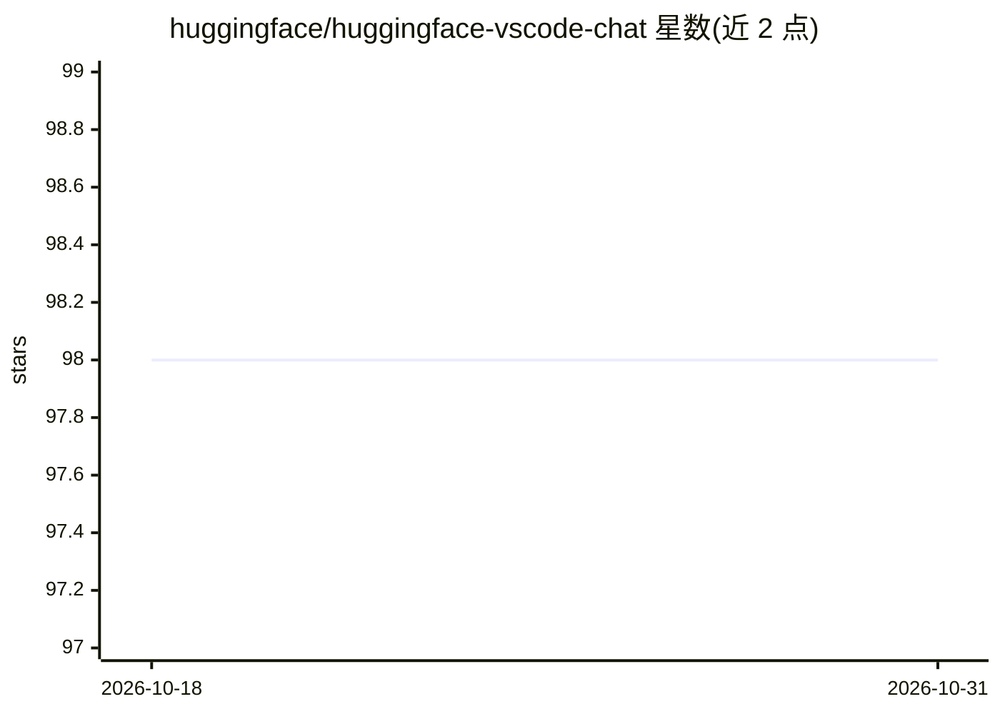

# huggingface/huggingface-vscode-chat

⭐ 98 · TypeScript · MIT · 推送 2026-09-23 · [GitHub](https://github.com/huggingface/huggingface-vscode-chat) · 组织维护

**在 VS Code Copilot Chat 中接入 Hugging Face Inference Providers 的扩展**

Hugging Face 官方维护的 VS Code 扩展，将 Hugging Face Inference Providers 注册为 GitHub Copilot Chat 的模型提供方，使用户可在 Copilot Chat 模型选择器中使用 Kimi K2、DeepSeek V3.1、GLM 4.5 等开源 LLM。需 VS Code 1.104.0+ 与带 inference.serverless 权限的 HF token；支持 cheapest/fastest 模式选择提供商，并支持将推理费用集中计入 Team/Enterprise 组织或资源组（X-HF-Bill-To 头）。开发方式为 git clone 后 npm 编译运行。

## 筛选速览

| 维度 | 判定 | 备注 |
|---|---|---|
| AI 角色 | `ai-ecosystem` | LLM/agent 周边工具 |
| 许可风险 | `permissive` | MIT |
| 部署形态 | `library` | 以包/库形式分发 |
| 模型依赖 | — | README 未给出锁定关系 |
| 硬件要求 | — | 无带数字的原话,不猜 |
| 安装摩擦 | `low` | 无编译、无系统依赖或容器化 |
| 成熟度 | — | 结构信号不足 |

## 能力要点

- 将 HF Inference Providers 注册为 Copilot Chat 模型提供方
- cheapest/fastest 两种模式按吞吐或单价选择提供商
- 组织/资源组统一计费（X-HF-Bill-To 头）

## 适用场景

- 在 Copilot Chat 中使用开源 LLM 而非默认模型
- 团队将成员推理费用集中计入组织账单
- 按价格或吞吐在多家推理提供商间切换

## 场景标签

`模型网关` · 领域:Agent 开发

## 证据(README 行号)

> L1: # 🤗 Hugging Face Provider for GitHub Copilot Chat
> L11: 4. Select "Hugging Face" provider.

## 星数曲线

2026-10-18 98 → 2026-10-31 98（+0）

---
*卡片 v1 · prompt 1.4 · 生成 2026-10-23 · 置信度 mid · 依据 README sha `164de3ed2562` · [字段定义](../../DATASET.md)*
