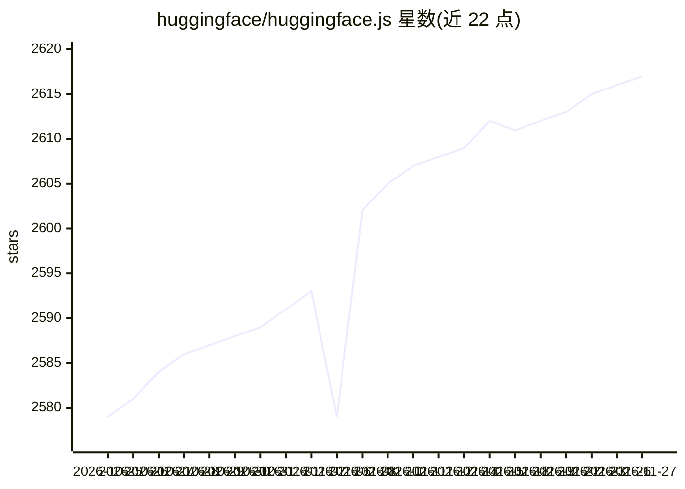

# huggingface/huggingface.js

⭐ 2,617 · TypeScript · MIT · 推送 2026-11-26 · [GitHub](https://github.com/huggingface/huggingface.js) · [官网](https://hf.co/docs/huggingface.js) · 组织维护

**面向 JS/TS 开发者的 Hugging Face API 客户端库集合**

一套与 Hugging Face API 交互的 JS 库集合，含 TS 类型：@huggingface/hub 管理仓库与文件提交/下载，@huggingface/inference 调用 Inference Providers 与专属推理端点访问 10 万+模型，另提供 MCP 客户端与微型 Agent 库、远程 GGUF 解析器、DDUF 解析、LeRobot 数据集读取、OpenUSD 网页查看器、任务定义文件、Jinja 聊天模板引擎等。依赖现代特性，仅支持现代浏览器与 Node.js >= 18 / Bun / Deno；README 自述库仍处早期阶段。

## 筛选速览

| 维度 | 判定 | 备注 |
|---|---|---|
| AI 角色 | `ai-ecosystem` | LLM/agent 周边工具 |
| 许可风险 | `permissive` | MIT |
| 部署形态 | `library` | 以包/库形式分发 |
| 模型依赖 | local-ok | 支持本地模型 |
| 硬件要求 | — | 无带数字的原话,不猜 |
| 安装摩擦 | `low` | 无编译、无系统依赖或容器化 |
| 成熟度 | `idea` | |

## 能力要点

- @huggingface/inference 调用 100,000+ 模型（serverless 或专属端点）
- @huggingface/hub 创建/删除仓库、提交/下载文件
- @huggingface/mcp-client 提供 MCP 客户端与微型 Agent 库
- 含远程 GGUF 解析器与 LeRobot 数据集读取器

## 适用场景

- 在 Node.js/浏览器中调用 Hugging Face 推理接口
- 用脚本管理 Hub 上的模型/数据集仓库与文件
- 在 JS 项目中接入 MCP 并构建可用工具的 Agent

## 场景标签

 · 领域:AI 生态/SDK 与客户端

## 证据(README 行号)

> L12: This is a collection of JS libraries to interact with the Hugging Face API, with TS types included.
> L15: - @huggingface/inference: Use all supported (serverless) Inference Providers or switch to Inference Endpoints (dedi
> L16: - @huggingface/mcp-client: A Model Context Protocol (MCP) client, and a tiny Agent library, built on top of Inferen

## 星数曲线

2026-10-25 2,579 → 2026-11-27 2,617（+38）

---
*卡片 v1 · prompt 1.4 · 生成 2026-11-23 · 置信度 high · 依据 README sha `2429ac9c8d50` · [字段定义](../../DATASET.md)*
