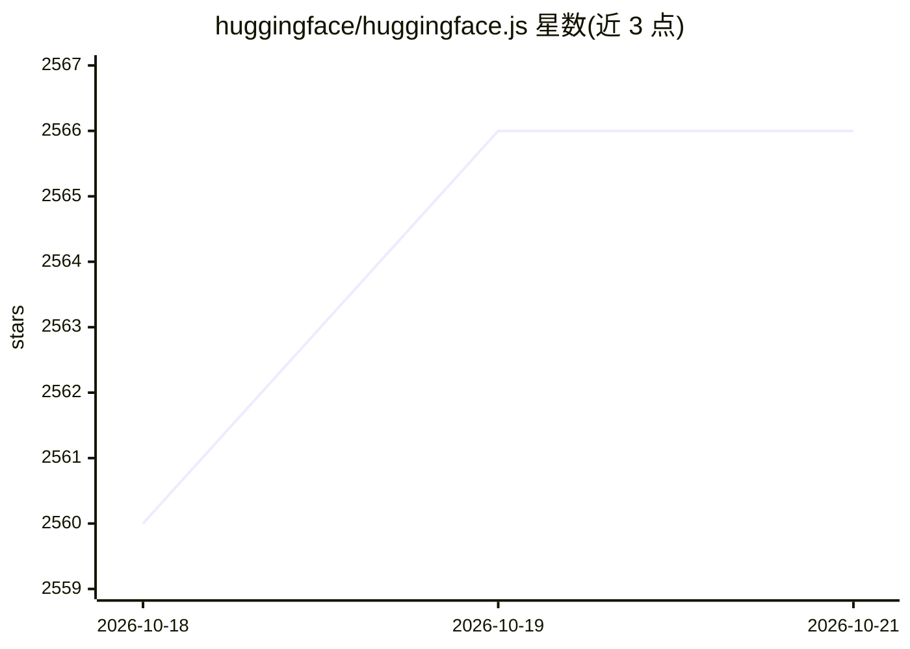

# huggingface/huggingface.js

⭐ 2,566 · TypeScript · MIT · 推送 2026-10-19 · [GitHub](https://github.com/huggingface/huggingface.js) · [官网](https://hf.co/docs/huggingface.js) · 组织维护

**Hugging Face 官方 JS 库集：用 JS/TS 接入 Hub 与模型推理**

由 Hugging Face 维护的 TypeScript/JavaScript 库集合：@huggingface/hub 用于以编程方式创建/删除仓库、提交与下载文件；@huggingface/inference 通过 Inference Providers 或专属 Inference Endpoints 调用 10 万+模型；另有 MCP 客户端与轻量 Agent 库、GGUF/DDUF/LeRobot 数据集解析器、OpenUSD 网页查看器、Jinja 聊天模板引擎、Ollama 兼容工具等约 12 个包。要求现代浏览器或 Node.js ≥ 18 / Bun / Deno，可通过 npm、CDN 或静态托管安装。

## 筛选速览

| 维度 | 判定 | 备注 |
|---|---|---|
| AI 角色 | `ai-ecosystem` | LLM/agent 周边工具 |
| 许可风险 | `permissive` | MIT |
| 部署形态 | `library` | 以包/库形式分发 |
| 模型依赖 | local-ok | 支持本地模型 |
| 硬件要求 | — | 无带数字的原话,不猜 |
| 安装摩擦 | `low` | 无编译、无系统依赖或容器化 |
| 成熟度 | `idea` | |

## 能力要点

- hub 库支持仓库创建/删除、文件提交与下载
- inference 库可调用 10 万+模型（serverless 或专属端点）
- 附带 MCP 客户端、tiny-agents、GGUF/LeRobot 解析器等多个工具库
- 无 polyfill、零依赖设计，支持现代浏览器与 Node.js ≥ 18

## 适用场景

- 在前端或 Node.js 项目中调用 Hugging Face 托管的模型
- 用脚本自动化 Hub 上的仓库与文件管理
- 解析 GGUF 文件或 LeRobot 机器人数据集
- 基于 MCP 客户端与 Agent 库构建带工具调用的 agent

## 场景标签

`推理引擎` `Agent 框架` · 领域:Agent 开发

## 证据(README 行号)

> L12: This is a collection of JS libraries to interact with the Hugging Face API, with TS types included.
> L15: - @huggingface/inference: Use all supported (serverless) Inference Providers or switch to Inference Endpoints (dedi

## 星数曲线

2026-10-18 2,560 → 2026-10-21 2,566（+6）

---
*卡片 v1 · prompt 1.4 · 生成 2026-10-21 · 置信度 high · 依据 README sha `20f84fe7af23` · [字段定义](../../DATASET.md)*
