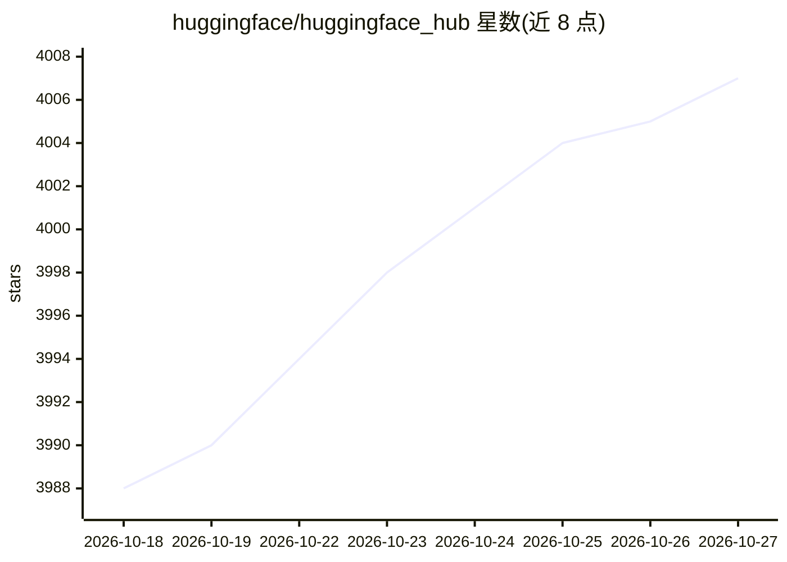

# huggingface/huggingface_hub

⭐ 4,007 · Python · Apache-2.0 · 推送 2026-10-24 · [GitHub](https://github.com/huggingface/huggingface_hub) · [官网](https://huggingface.co/docs/huggingface_hub) · 组织维护

**面向开发者的 Hugging Face Hub 官方 Python 客户端与 hf CLI**

Hugging Face 官方维护的 Python 库与命令行工具，用于与 Hub 平台交互：下载/上传模型与数据集文件、创建和管理仓库、运行推理与 Jobs、搜索模型/数据集/Spaces、发布 Model Card 及社区协作。文件下载后进入本地缓存，存储后端基于 Xet 做大文件版本管理。CLI 面向人类与编码 agent 双场景（同一命令按运行者调整输出），可通过 hf skills add 生成命令参考技能供 Claude Code、Codex、Cursor 等加载；另有 MCP 可选依赖。安装途径为独立安装脚本或 pip/uv。

## 筛选速览

| 维度 | 判定 | 备注 |
|---|---|---|
| AI 角色 | `ai-ecosystem` | LLM/agent 周边工具 |
| 许可风险 | `permissive` | Apache-2.0 |
| 部署形态 | `library` | 以包/库形式分发 |
| 模型依赖 | — | README 未给出锁定关系 |
| 硬件要求 | — | 无带数字的原话,不猜 |
| 安装摩擦 | `low` | 无编译、无系统依赖或容器化 |
| 成熟度 | — | 结构信号不足 |

## 能力要点

- 单一包提供 hf CLI 与 Python 库两套接口
- 支持文件/整仓下载与上传、仓库管理、推理与 Jobs 运行
- CLI 输出适配编码 agent，可生成 .agents/skills 命令技能
- 基于 Xet 的内置大文件版本管理与 CDN 地理分发下载

## 适用场景

- 在训练/部署脚本中下载预训练模型与数据集文件
- 把训练好的模型或数据集上传到 Hub 托管与分享
- 在终端或编码 agent 中管理 Hub 上的仓库与社区协作

## 场景标签

 · 领域:机器学习基础设施/模型分发

## 证据(README 行号)

> L3:  The official CLI and Python client for the Hugging Face Hub.
> L56: The `huggingface_hub` library allows you to interact with the Hugging Face Hub, a platform democratizing open-sourc
> L61: - Run Inference on deployed models.

## 星数曲线

2026-10-18 3,988 → 2026-10-27 4,007（+19）

---
*卡片 v1 · prompt 1.4 · 生成 2026-10-21 · 置信度 high · 依据 README sha `91ffab3d976c` · [字段定义](../../DATASET.md)*
