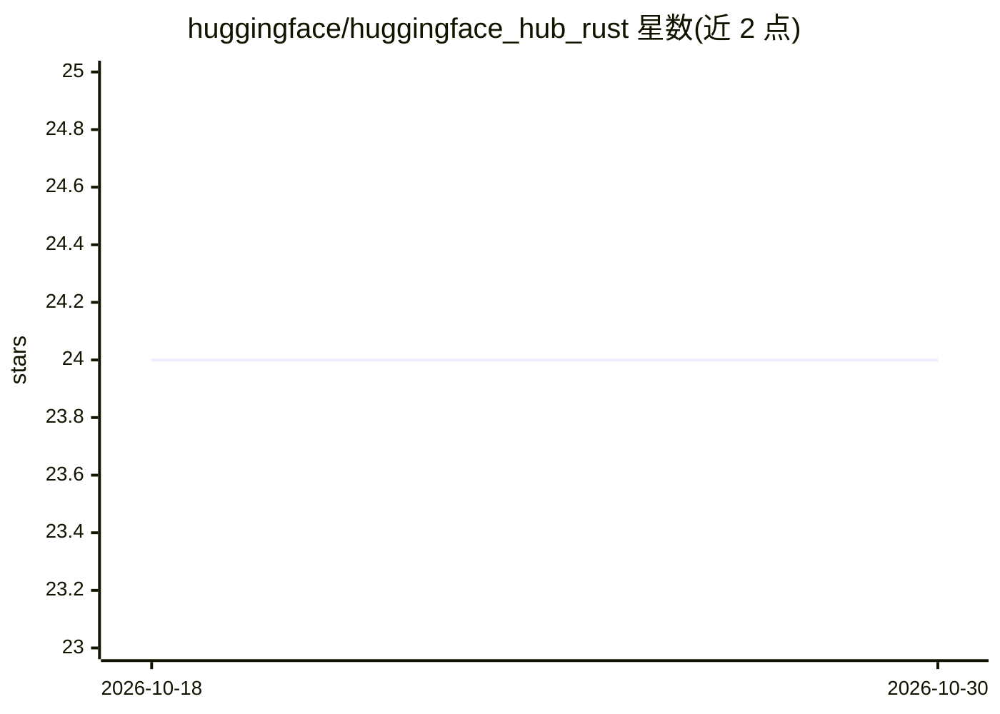

# huggingface/huggingface_hub_rust

⭐ 24 · Rust · Apache-2.0 · 推送 2026-09-23 · [GitHub](https://github.com/huggingface/huggingface_hub_rust) · 组织维护

**Rust 版 Hugging Face Hub 客户端库，操作模型库与数据集**

异步 Rust 客户端库，提供 Hugging Face Hub API 的类型化接口，功能覆盖仓库元数据查询与增删改、文件上传下载、多文件提交与 diff 查看、分支标签管理、用户组织信息、流式分页列举，以及可选的 Xet 高性能传输（feature flag 控制）。附带 hfrs 命令行工具。README 声明库处于实验阶段，API 可能随版本变更。认证令牌按 builder、环境变量、token 文件顺序解析。

## 筛选速览

| 维度 | 判定 | 备注 |
|---|---|---|
| AI 角色 | `ai-ecosystem` | LLM/agent 周边工具 |
| 许可风险 | `permissive` | Apache-2.0 |
| 部署形态 | `library` | 以包/库形式分发 |
| 模型依赖 | — | README 未给出锁定关系 |
| 硬件要求 | — | 无带数字的原话,不猜 |
| 安装摩擦 | `low` | 无编译、无系统依赖或容器化 |
| 成熟度 | `idea` | |

## 能力要点

- 仓库/文件/提交/分支标签全操作覆盖
- 流式分页返回 impl Stream 的惰性迭代
- 可选 Xet 存储后端高性能传输（xet feature）
- 附带 hfrs CLI 工具

## 适用场景

- 在 Rust 项目中集成 Hugging Face Hub 的模型与数据集下载上传
- 编写管理 Hub 仓库、分支与提交的自动化脚本
- 通过 hfrs 在终端直接操作 Hub

## 场景标签

 · 领域:AI 生态基础设施/开发者库

## 证据(README 行号)

> L5: Async Rust client for the Hugging Face Hub API.
> L7: `huggingface-hub` provides a typed, ergonomic interface for interacting with the Hugging Face Hub from Rust. It is t

## 星数曲线

2026-10-18 24 → 2026-10-30 24（+0）

---
*卡片 v1 · prompt 1.4 · 生成 2026-10-27 · 置信度 high · 依据 README sha `89a53f6d3c21` · [字段定义](../../DATASET.md)*
