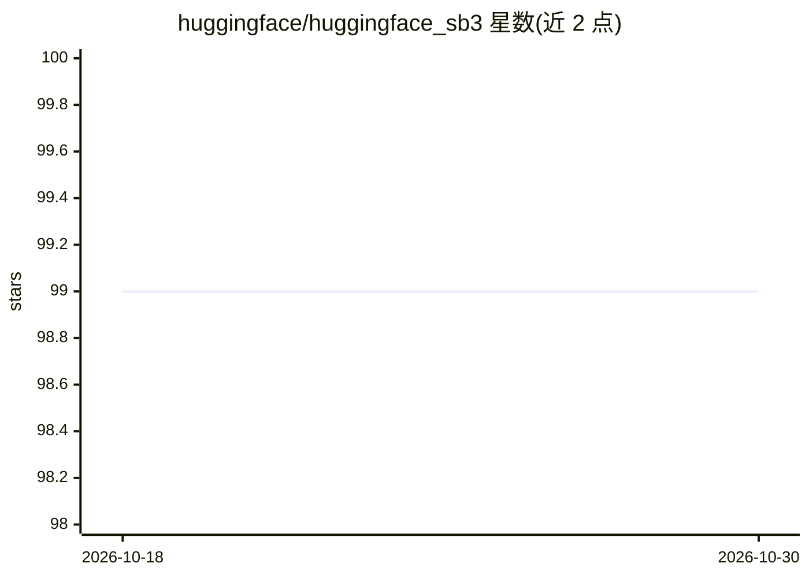

# huggingface/huggingface_sb3

⭐ 99 · Jupyter Notebook · 推送 2026-09-23 · [GitHub](https://github.com/huggingface/huggingface_sb3) · 组织维护

**为 Stable-Baselines3 提供 Hub 模型上传下载的辅助库**

Hugging Face 官方维护的 Stable-Baselines3 扩展库：从 Hub 下载训练好的 RL 智能体模型，或将训练后的模型保存、评估、生成模型卡并录制回放视频后推送到 Hub。提供 package_to_hub 与 push_to_hub 两种上传函数（前者目前支持 Gym 与 Atari 环境），另含 EnvironmentName/ModelName/ModelRepoId 等命名辅助类用于批量自动化上传下载。需登录 Hugging Face 账号；若使用旧版 Gym 需固定安装 huggingface_sb3==2.3.1。

## 筛选速览

| 维度 | 判定 | 备注 |
|---|---|---|
| AI 角色 | `ai-ecosystem` | LLM/agent 周边工具 |
| 许可风险 | `none` | — |
| 部署形态 | `library` | 以包/库形式分发 |
| 模型依赖 | — | README 未给出锁定关系 |
| 硬件要求 | — | 无带数字的原话,不猜 |
| 安装摩擦 | `low` | 无编译、无系统依赖或容器化 |
| 成熟度 | — | 结构信号不足 |

## 能力要点

- package_to_hub() 保存、评估、生成模型卡并录制回放视频后上传 Hub
- 从 Hub 下载 Stable-Baselines3 模型（需设 TRUST_REMOTE_CODE=True）
- EnvironmentName/ModelName/ModelRepoId 命名辅助类支持批量自动化
- 提供 Colab 与无屏机器的 xvfb 运行方案

## 适用场景

- 把训练好的 RL 智能体上传到 Hugging Face Hub 托管
- 下载他人分享的 SB3 模型做复现或继续训练
- 批量自动化多个环境模型的上传下载

## 场景标签

`强化学习` · 领域:训练与推理

## 证据(README 行号)

> L3: A library to load and upload Stable-baselines3 models from the Hub with Gymnasium and Gymnasium compatible environme
> L30: With `package_to_hub()` **we'll save, evaluate, generate a model card and record a replay video of your agent befor

## 星数曲线

2026-10-18 99 → 2026-10-30 99（+0）

---
*卡片 v1 · prompt 1.4 · 生成 2026-10-23 · 置信度 high · 依据 README sha `e447031c36a0` · [字段定义](../../DATASET.md)*
