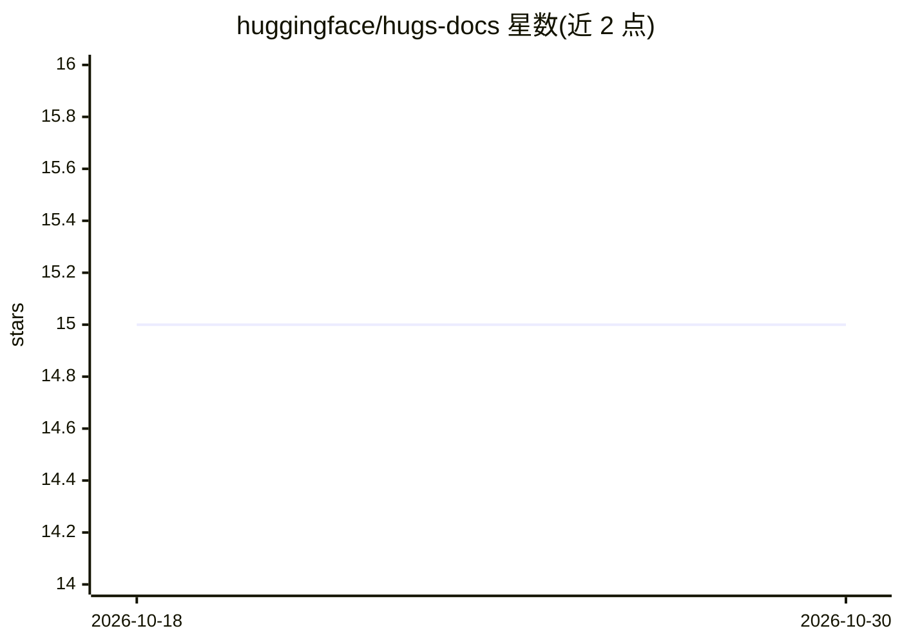

# huggingface/hugs-docs

⭐ 15 · 推送 2026-10-06 · [GitHub](https://github.com/huggingface/hugs-docs) · [官网](https://huggingface.co/docs/hugs) · 组织维护

**HUGS（Hugging Face 生成式 AI 服务）官方文档仓库，已弃用**

Hugging Face Generative AI Services（HUGS）的官方文档仓库。README 声明：自 2025 年 9 月更新起，HUGS 已弃用，不再提供 HUGS 部署，该实验已停止。仓库内容为文档，面向曾使用或了解 HUGS 部署服务的开发者与用户，当前不再提供可用的服务部署途径。

## 筛选速览

| 维度 | 判定 | 备注 |
|---|---|---|
| AI 角色 | `ai-ecosystem` | LLM/agent 周边工具 |
| 许可风险 | `none` | — |
| 部署形态 | `None` |  |
| 模型依赖 | — | README 未给出锁定关系 |
| 硬件要求 | — | 无带数字的原话,不猜 |
| 安装摩擦 | `low` | 无编译、无系统依赖或容器化 |
| 成熟度 | — | 结构信号不足 |

## 能力要点

- HUGS 官方文档
- README 声明 HUGS 已弃用并不再提供部署

## 适用场景

- 查阅 HUGS 服务的官方文档与弃用声明

## 场景标签

 · 领域:AI 服务文档

## 证据(README 行号)

> L1: # Documentation for Hugging Face Generative AI Services (HUGS)
> L6: > September 2025 Update: HUGS is currently deprecated.

## 星数曲线

2026-10-18 15 → 2026-10-30 15（+0）

---
*卡片 v1 · prompt 1.4 · 生成 2026-10-30 · 置信度 mid · 依据 README sha `194c63a8794c` · [字段定义](../../DATASET.md)*
