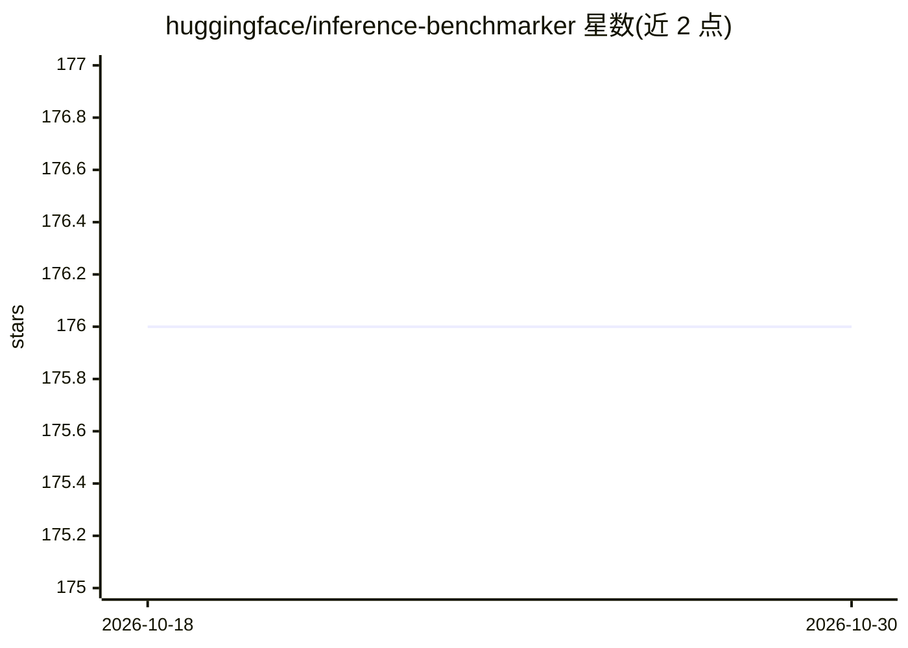

# huggingface/inference-benchmarker

⭐ 176 · Rust · Apache-2.0 · 推送 2026-09-23 · [GitHub](https://github.com/huggingface/inference-benchmarker) · 组织维护

**给部署者的 LLM 推理服务器基准测试工具**

Hugging Face 维护的 Rust 命令行基准测试工具，面向暴露 OpenAI 兼容 API 的文本生成服务器（如 TGI、vLLM）。支持 sweep/rate/throughput 三种模式与 chat、code-generation、classification、fixed-length 四种预设 profile，采用开环恒定到达率模拟真实负载；提示词与解码选项可按 token 数和方差采样，默认使用 ShareGPT 子集数据集。结果以 JSON 输出，附带 Gradio 可视化、Kubernetes Helm chart 与 Slurm 部署示例。通过 cargo、二进制或 Docker 安装。

## 筛选速览

| 维度 | 判定 | 备注 |
|---|---|---|
| AI 角色 | `ai-ecosystem` | LLM/agent 周边工具 |
| 许可风险 | `permissive` | Apache-2.0 |
| 部署形态 | `self-host` | docker 或自建部署 |
| 模型依赖 | local-ok | 支持本地模型 |
| 硬件要求 | — | 无带数字的原话,不猜 |
| 安装摩擦 | `low` | 无编译、无系统依赖或容器化 |
| 成熟度 | — | 结构信号不足 |

## 能力要点

- 对任意 OpenAI 兼容 API 的文本生成服务器做基准测试
- sweep/rate/throughput 三种模式，开环恒定到达率模拟真实负载
- chat/code-generation/classification/fixed-length 四种 benchmark profile
- 提供 Gradio 结果可视化、Kubernetes Helm chart 与 Slurm 部署示例

## 适用场景

- 对比不同推理服务器在真实负载下的吞吐与延迟
- 上线前找出部署的性能瓶颈并调优
- 考察 prefix caching 对 chat/分类场景性能的影响

## 场景标签

`模型评测` · 领域:评测与运维

## 证据(README 行号)

> L8: **Inference Benchmarker** is designed to streamline this process by providing a comprehensive benchmarking tool
> L13: It can be used to benchmark any text generation server that exposes an OpenAI-compliant API.
> L17: * Broad Compatibility: Benchmarks any text generation server with an OpenAPI-compliant chat API.

## 星数曲线

2026-10-18 176 → 2026-10-30 176（+0）

---
*卡片 v1 · prompt 1.4 · 生成 2026-10-22 · 置信度 mid · 依据 README sha `50a51056736d` · [字段定义](../../DATASET.md)*
