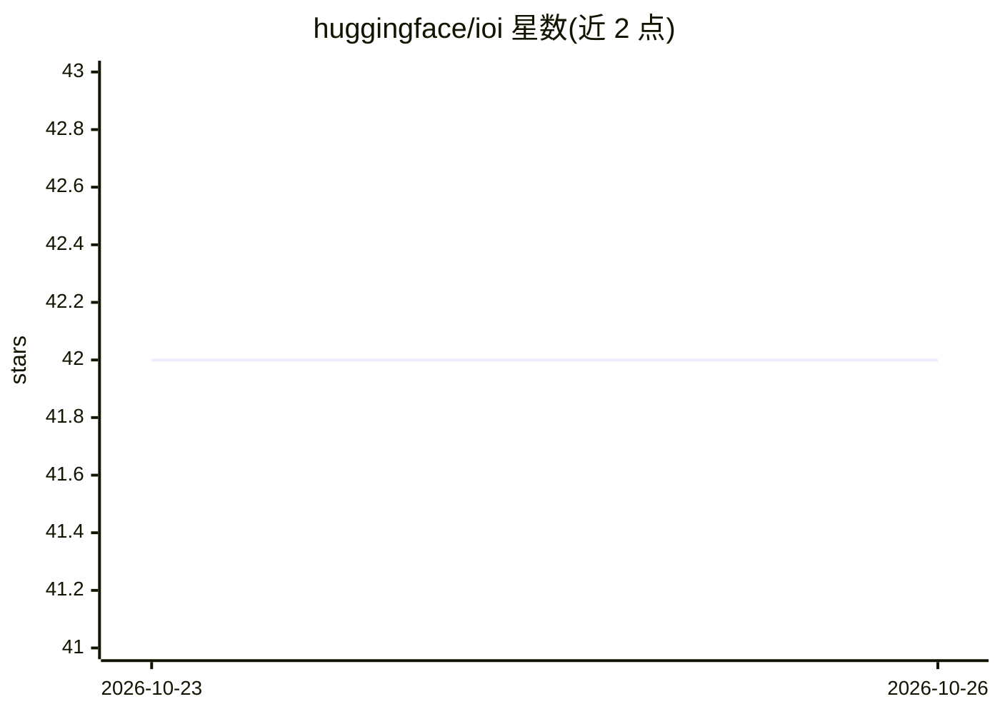

# huggingface/ioi

⭐ 42 · Python · 推送 2026-10-22 · [GitHub](https://github.com/huggingface/ioi) · 组织维护

**国际信息学奥赛（IOI）评测数据集与模型解题评估工具集**

Hugging Face 维护的 IOI 评测项目：提供 IOI'2020-2024 题面数据集、测试用例、官方标准解，以及 40+ 模型在 IOI'2024 上的评估数据。仓库包含两个工作流程：generate 目录指导用模型生成 IOI 题目的解答，run_tests 目录指导对生成的解答运行测试。README 未给出具体安装命令与依赖细节。

## 筛选速览

| 维度 | 判定 | 备注 |
|---|---|---|
| AI 角色 | `ai-knowledge` | 知识聚合/清单类 |
| 许可风险 | `none` | — |
| 部署形态 | `None` |  |
| 模型依赖 | — | README 未给出锁定关系 |
| 硬件要求 | — | 无带数字的原话,不猜 |
| 安装摩擦 | `low` | 无编译、无系统依赖或容器化 |
| 成熟度 | — | 结构信号不足 |

## 能力要点

- 收录 IOI'2020-2024 题面、测试用例与官方标准解数据集
- 提供 40+ 模型在 IOI'2024 上的评估数据
- 包含模型解答生成（generate）与测试运行（run_tests）两个流程

## 适用场景

- 评估大模型在竞赛编程题上的解题能力
- 获取 IOI 历年题目与测试用例做基准测试
- 复现或对比 40+ 模型在 IOI'2024 的表现

## 场景标签

`模型评测` · 领域:评测与运维

## 证据(README 行号)

> L3: IOI Evals
> L6: - Problem statements dataset (IOI’2020 - IOI’2024): `open-r1/ioi`
> L9: - Evaluation data for 40+ leading models on IOI’2024: `open-r1/ioi-2024-model-solutions`

## 星数曲线

2026-10-23 42 → 2026-10-26 42（+0）

---
*卡片 v1 · prompt 1.4 · 生成 2026-10-25 · 置信度 mid · 依据 README sha `126d3e2ee00d` · [字段定义](../../DATASET.md)*
