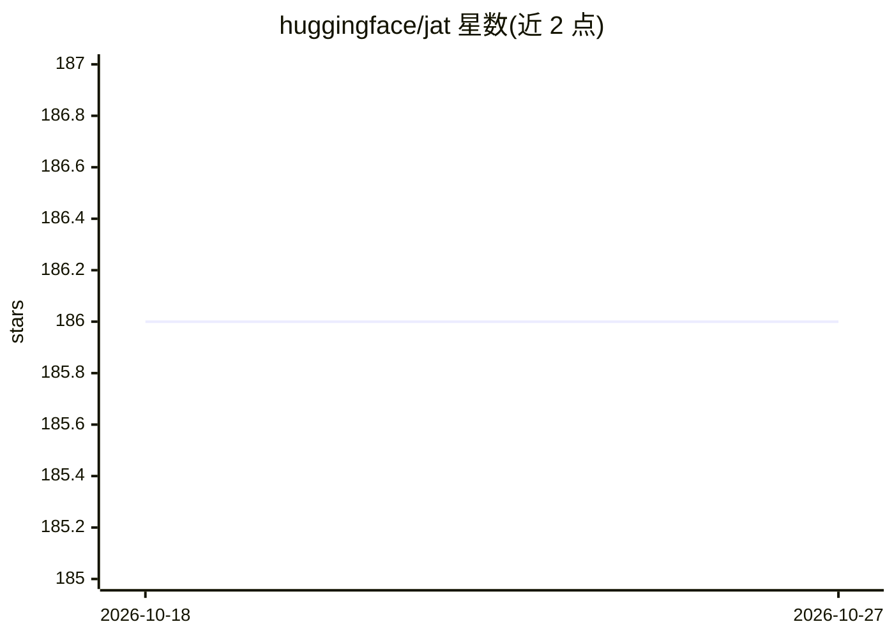

# huggingface/jat

⭐ 186 · Python · Apache-2.0 · 推送 2026-09-23 · [GitHub](https://github.com/huggingface/jat) · 组织维护

**多任务深度强化学习 Transformer 智能体（JAT）**

Hugging Face 团队发布的多用途 Transformer 智能体 JAT：在 Atari 57、BabyAI、Meta-World、MuJoCo 等强化学习任务，以及 Wikipedia、OSCAR 文本任务和 OK VQA、Conceptual Captions 视觉问答任务上联合训练。提供预训练模型评估脚本与从零训练脚本（训练示例在 8xA100 上运行），训练数据集托管于 Hugging Face。通过 transformers AutoModelForCausalLM 加载，本地需 git clone 后 pip 安装依赖。

## 筛选速览

| 维度 | 判定 | 备注 |
|---|---|---|
| AI 角色 | `ai-native` | 本体是模型或模型工具 |
| 许可风险 | `permissive` | Apache-2.0 |
| 部署形态 | `None` |  |
| 模型依赖 | — | README 未给出锁定关系 |
| 硬件要求 | — | 无带数字的原话,不猜 |
| 安装摩擦 | `low` | 无编译、无系统依赖或容器化 |
| 成熟度 | — | 结构信号不足 |

## 能力要点

- 在强化学习、文本、视觉问答多类任务上联合训练
- 提供预训练模型评估与从零训练脚本
- 训练数据集（jat-project/jat-dataset）公开发布
- 通过 transformers AutoModelForCausalLM 加载使用

## 适用场景

- 在 Atari/MuJoCo 等环境上评估多任务智能体表现
- 基于公开数据集复现或继续训练智能体
- 研究生任务联合训练的下游微调

## 场景标签

`强化学习` `模型训练` · 领域:训练与推理

## 证据(README 行号)

> L1: # Jack of All Trades, Master of Some, a Multi-Purpose Transformer Agent
> L49: - **Training JAT**: Train your own JAT model from scratch (run on 8xA100)

## 星数曲线

2026-10-18 186 → 2026-10-27 186（+0）

---
*卡片 v1 · prompt 1.4 · 生成 2026-10-22 · 置信度 high · 依据 README sha `279c2bcff3f6` · [字段定义](../../DATASET.md)*
