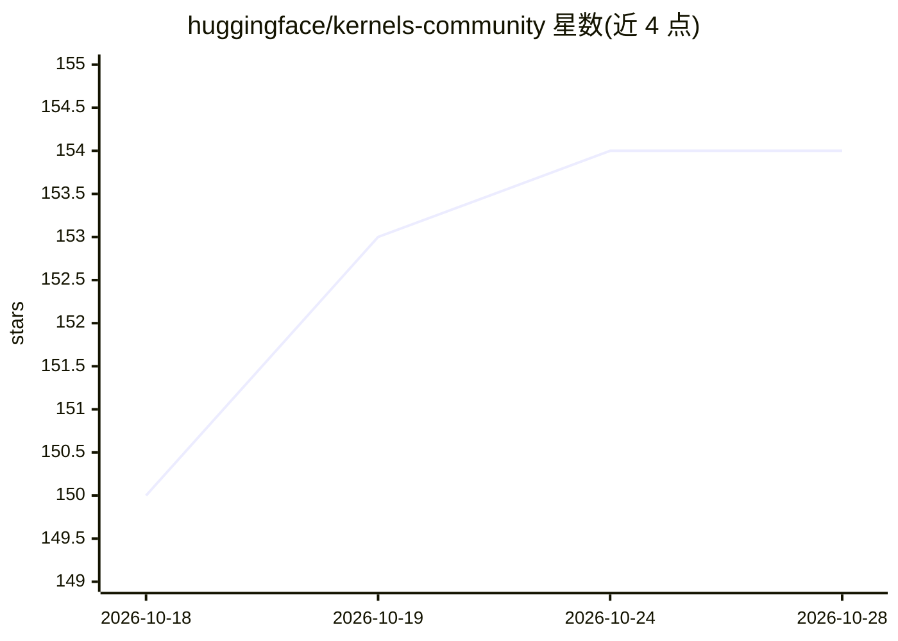

# huggingface/kernels-community

⭐ 154 · C++ · 推送 2026-10-27 · [GitHub](https://github.com/huggingface/kernels-community) · 组织维护

**Hugging Face Kernel Hub 的内核源码仓库**

Hugging Face 维护的 kernels-community 组织下计算内核（compute kernels）的源码仓库，对应 hf.co/kernels-community 页面。Kernel Hub 允许 Python 库与应用直接从 Hub 加载计算内核；本仓库即这些内核的源码集合，通过 PR 与 CI（PR 标题格式为 'example: 简述' 时触发对应内核的 CI）接受社区贡献，提交前需阅读 Contributing Guidelines。README 未列出具体内核清单与安装命令。

## 筛选速览

| 维度 | 判定 | 备注 |
|---|---|---|
| AI 角色 | `ai-ecosystem` | LLM/agent 周边工具 |
| 许可风险 | `none` | — |
| 部署形态 | `None` |  |
| 模型依赖 | — | README 未给出锁定关系 |
| 硬件要求 | — | 无带数字的原话,不猜 |
| 安装摩擦 | `low` | 无编译、无系统依赖或容器化 |
| 成熟度 | — | 结构信号不足 |

## 能力要点

- Kernel Hub 支持 Python 库/应用直接从 Hub 加载计算内核
- 本仓库为 hf.co/kernels-community 内核的源码
- 按 PR 标题格式匹配内核并运行对应 CI

## 适用场景

- 为 Kernel Hub 内核提交源码修改或新内核
- 了解社区计算内核的源码实现

## 场景标签

 · 领域:AI 基础设施/计算内核

## 证据(README 行号)

> L7: The Kernel Hub allows Python libraries and applications to load compute
> L11: This repository contains sources for the kernels in hf.co/kernels-community.

## 星数曲线

2026-10-18 150 → 2026-10-28 154（+4）

---
*卡片 v1 · prompt 1.4 · 生成 2026-10-22 · 置信度 mid · 依据 README sha `bce8caff8ee4` · [字段定义](../../DATASET.md)*
