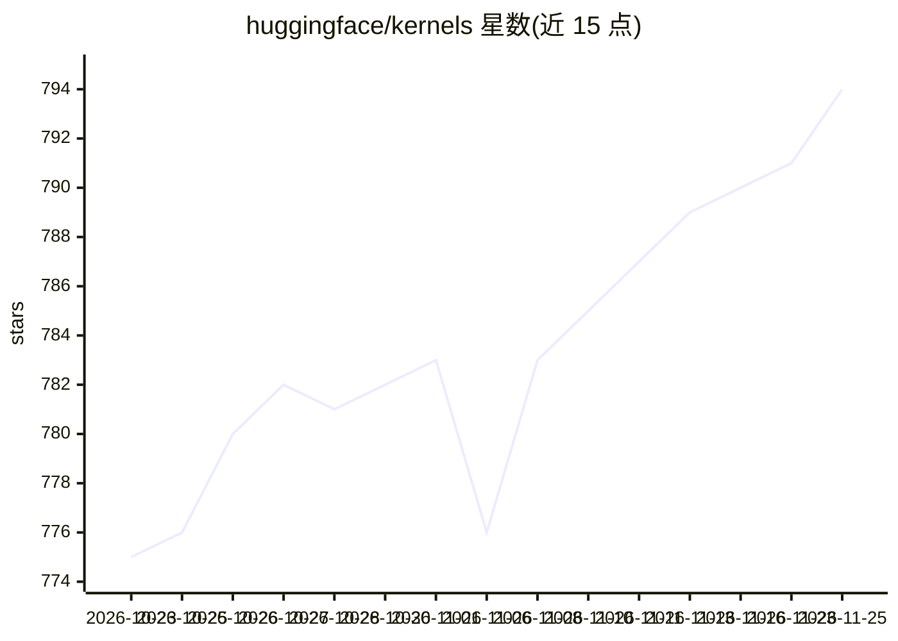

# huggingface/kernels

⭐ 794 · Python · Apache-2.0 · 推送 2026-11-23 · [GitHub](https://github.com/huggingface/kernels) · [官网](https://huggingface.co/docs/kernels/) · 组织维护

**从 Hub 动态加载计算内核的 Python 库**

Hugging Face 的 kernels 项目由两部分组成：`kernels` Python 包允许库和应用直接从 Hub 动态加载计算内核，内核可在 PYTHONPATH 之外加载、同一进程可共存多个版本，并需兼容多版本 Python 与各 PyTorch 构建配置；`kernel-builder` 供内核作者构建内核。安装需 torch>=2.5 与 CUDA。项目还维护 kernels-community 内核集，硬件按支持层级划分。

## 筛选速览

| 维度 | 判定 | 备注 |
|---|---|---|
| AI 角色 | `ai-ecosystem` | LLM/agent 周边工具 |
| 许可风险 | `permissive` | Apache-2.0 |
| 部署形态 | `library` | 以包/库形式分发 |
| 模型依赖 | — | README 未给出锁定关系 |
| 硬件要求 | — | 无带数字的原话,不猜 |
| 安装摩擦 | `medium` | 含编译或系统依赖之一 |
| 成熟度 | — | 结构信号不足 |

## 能力要点

- 从 Hub 动态加载计算内核，可加载 PYTHONPATH 之外的路径
- 同一 Python 进程可加载同一内核的多个版本
- kernel-builder 支持构建内核，按 Tier 划分硬件支持（CUDA/CPU/ROCm/Metal 为 Tier 1）
- Hugging Face 维护 kernels-community 内核集

## 适用场景

- Python 库或应用按需从 Hub 加载计算内核
- 内核作者用 kernel-builder 构建并发布内核
- 同一进程中需要共存多版本内核的场景

## 场景标签

 · 领域:AI 基础设施/推理优化

## 证据(README 行号)

> L15: The Kernel Hub allows Python libraries and applications to load compute
> L29: - You can load kernels from the Hub using the `kernels` Python package.
> L30: - If you are a kernel author, you can build your kernels with kernel-builder.

## 星数曲线

2026-10-23 775 → 2026-11-25 794（+19）

---
*卡片 v1 · prompt 1.4 · 生成 2026-11-25 · 置信度 high · 依据 README sha `8bdb9fe7df79` · [字段定义](../../DATASET.md)*
