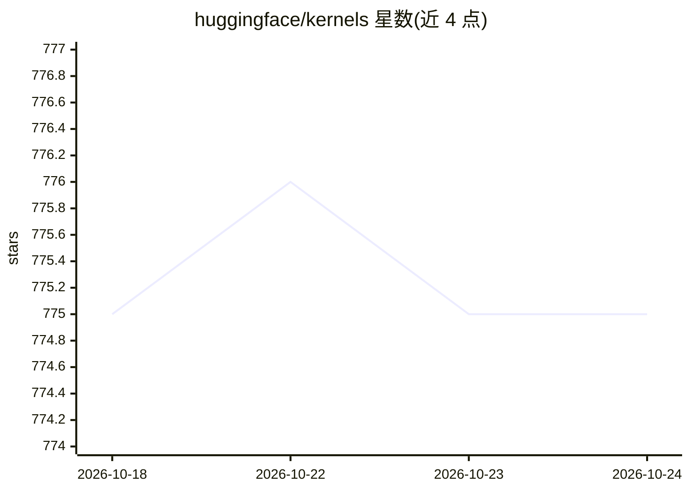

# huggingface/kernels

⭐ 776 · Python · Apache-2.0 · 推送 2026-10-24 · [GitHub](https://github.com/huggingface/kernels) · [官网](https://huggingface.co/docs/kernels/) · 组织维护

**从 Hugging Face Hub 动态加载计算内核的 Python 库与构建工具**

Kernel Hub 生态的客户端与构建工具：`kernels` Python 包支持在运行时从 Hub 加载计算内核（可从 PYTHONPATH 外加载、同进程多版本共存），kernel-builder 供内核作者构建产物，kernels-community 为官方维护的内核集。内核需兼容多版本 Python、PyTorch 各 CUDA/C++ ABI 配置及旧版 C 库。安装需 torch>=2.5 与 CUDA；硬件支持分三档：CUDA/CPU 为 Tier 1（CI 验证），ROCm/XPU/Metal/TPU 为 Tier 2，Neuron 支持处实验阶段且包未公开。

## 筛选速览

| 维度 | 判定 | 备注 |
|---|---|---|
| AI 角色 | `ai-ecosystem` | LLM/agent 周边工具 |
| 许可风险 | `permissive` | Apache-2.0 |
| 部署形态 | `library` | 以包/库形式分发 |
| 模型依赖 | — | README 未给出锁定关系 |
| 硬件要求 | — | 无带数字的原话,不猜 |
| 安装摩擦 | `medium` | 含编译或系统依赖之一 |
| 成熟度 | `idea` | |

## 能力要点

- 从 Hub 动态加载内核，同进程可加载同内核多版本
- kernel-builder 支持作者构建跨 Python/PyTorch 版本的内核
- 硬件支持分档：CUDA/CPU Tier 1（CI 验证），ROCm/XPU/Metal/TPU Tier 2
- 官方维护 kernels-community 内核集

## 适用场景

- 在 PyTorch 应用中按需加载 Hub 上的计算内核
- 内核作者构建并发布兼容多硬件的内核
- 浏览 huggingface.co/kernels 查找可用内核

## 场景标签

 · 领域:AI 基础设施/计算内核

## 证据(README 行号)

> L15: The Kernel Hub allows Python libraries and applications to load compute
> L30: - If you are a kernel author, you can build your kernels with kernel-builder.

## 星数曲线

2026-10-18 775 → 2026-10-24 775（+0）

---
*卡片 v1 · prompt 1.4 · 生成 2026-10-21 · 置信度 high · 依据 README sha `02646b7614b7` · [字段定义](../../DATASET.md)*
