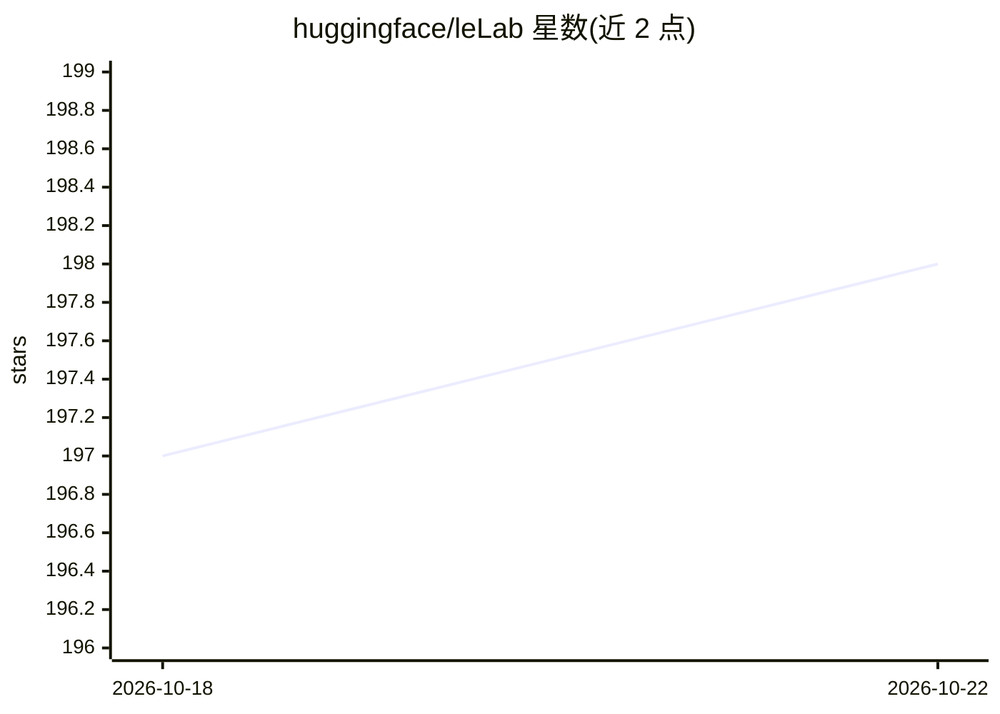

# huggingface/leLab

⭐ 198 · TypeScript · Apache-2.0 · 推送 2026-10-14 · [GitHub](https://github.com/huggingface/leLab) · [官网](https://huggingface.co/spaces/lerobot/LeLab) · 组织维护

**LeRobot 机器人学习工作流的官方 Web 图形界面**

Hugging Face LeRobot 团队维护的 Web 应用，把机械臂机器人学习全流程——校准、遥操作、录制数据集、浏览回放、启动训练、运行策略推理——集中到单一浏览器界面。用户接入机械臂后通过网页完成标定与数据采集，录制 LeRobotDataset 并可一键上传 Hugging Face Hub。支持相机旋转设置（0°/90°/180°/270°）。通过 LeLab Space 提供的单行命令安装运行，面向希望跳过命令行的新手。

## 筛选速览

| 维度 | 判定 | 备注 |
|---|---|---|
| AI 角色 | `ai-ecosystem` | LLM/agent 周边工具 |
| 许可风险 | `permissive` | Apache-2.0 |
| 部署形态 | `None` |  |
| 模型依赖 | — | README 未给出锁定关系 |
| 硬件要求 | — | 无带数字的原话,不猜 |
| 安装摩擦 | `low` | 无编译、无系统依赖或容器化 |
| 成熟度 | — | 结构信号不足 |

## 能力要点

- 覆盖校准/遥操作/录制/训练/推理/回放的单一 Web 界面
- 录制 LeRobotDataset 并一键上传 Hugging Face Hub
- 相机旋转设置（0°/90°/180°/270°）应用于预览、录制与推理
- 单条命令安装并运行 LeLab + LeRobot

## 适用场景

- 机械臂到手后用网页界面完成标定、遥操作和数据录制
- 不写命令行就启动 LeRobot 训练并看实时日志
- 在浏览器里逐帧查看数据集并运行训练好的策略

## 场景标签

 · 领域:机器人/机器学习工具

## 证据(README 行号)

> L3:  The official graphical interface for LeRobot.
> L9: **LeLab** is a web app that puts the full LeRobot workflow — calibrate, teleoperate, record, train, replay — into a 

## 星数曲线

2026-10-18 197 → 2026-10-22 198（+1）

---
*卡片 v1 · prompt 1.4 · 生成 2026-10-22 · 置信度 high · 依据 README sha `264931fc2a6e` · [字段定义](../../DATASET.md)*
