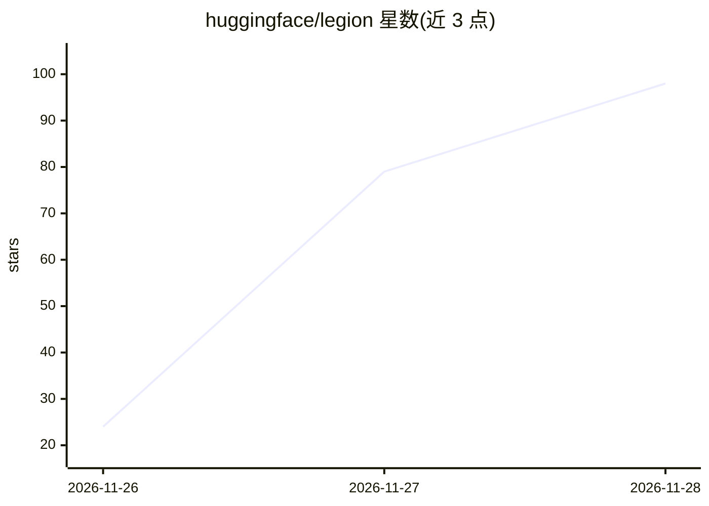

# huggingface/legion

⭐ 98 · Python · 推送 2026-11-27 · [GitHub](https://github.com/huggingface/legion) · 组织维护

**在容器中协作运行多智能体团队并汇报进度的编排工具**

Legion 是 Hugging Face 开源的多智能体协作编排 CLI：每个 agent 运行在独立容器中，通过共享消息板交流、使用共享服务；控制层启动 agent、维护会话状态并汇报进度与模型用量。可在本地笔记本、Hugging Face Jobs 或 Slurm 上运行，模型端点支持 Inference Providers 或 OpenAI 兼容接口，工具以 Python 函数形式添加；任务以 Harbor 格式的数据集发布。当前支持 Pi 作为 agent harness，官方声明处于早期阶段、API 可能破坏性变更，需固定 commit 保证稳定。

## 筛选速览

| 维度 | 判定 | 备注 |
|---|---|---|
| AI 角色 | `ai-ecosystem` | LLM/agent 周边工具 |
| 许可风险 | `none` | — |
| 部署形态 | `None` |  |
| 模型依赖 | — | README 未给出锁定关系 |
| 硬件要求 | — | 无带数字的原话,不猜 |
| 安装摩擦 | `low` | 无编译、无系统依赖或容器化 |
| 成熟度 | `idea` | |

## 能力要点

- 每个 agent 独立容器运行，经消息板共享发现并协作
- 本地/HF Jobs/Slurm 三种执行环境
- 模型端点支持 Inference Providers 与 OpenAI 兼容接口
- 以 Python 函数定义工具，通过 spec.yaml 配置 swarm

## 适用场景

- 让多个 agent 分工协作完成 Harbor 任务环境中的问题
- 在 Slurm 集群上批量运行 agent 试验并追踪用量
- 发布自定义任务数据集并接入 swarm 运行

## 场景标签

`多智能体` · 领域:Agent 开发

## 证据(README 行号)

> L5: Run collaborating teams of agents on Harbor tasks. Each agent works in its own
> L20: Legion coordinates Harbor agent trials, task environments, inference, and shared resources; the controller tracks s

## 星数曲线

2026-11-26 24 → 2026-11-28 98（+74）

---
*卡片 v1 · prompt 1.4 · 生成 2026-11-26 · 置信度 high · 依据 README sha `a0187f5f9b85` · [字段定义](../../DATASET.md)*
