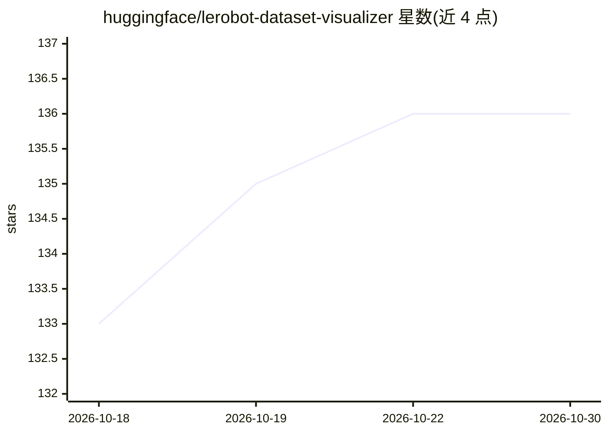

# huggingface/lerobot-dataset-visualizer

⭐ 136 · TypeScript · Apache-2.0 · 推送 2026-10-22 · [GitHub](https://github.com/huggingface/lerobot-dataset-visualizer) · [官网](https://huggingface.co/spaces/lerobot/visualize_dataset) · 组织维护

**LeRobot 格式机器人数据集的可视化 Web 工具**

基于 Next.js/React 的 Web 应用，用于交互式浏览和检查 LeRobot 格式的机器人数据集：拉取元数据与 episode 数据，提供同步视频播放与时序图表、数据集统计、动作质量分析（自相关/速度分布/跨episode方差热图）、问题 episode 过滤标记、基于 URDF 的 3D 机器人位姿可视化，以及 v3.1 语言标注编辑（可选 FastAPI 后端负责 parquet 重写与推送 Hub）。面向机器人研究人员与从业者，用 Bun 管理依赖，支持 Docker 部署（HF Spaces 配置 sdk: docker，端口 7860）。

## 筛选速览

| 维度 | 判定 | 备注 |
|---|---|---|
| AI 角色 | `ai-enhanced` | 去掉 AI 部分产品仍成立 |
| 许可风险 | `permissive` | Apache-2.0 |
| 部署形态 | `self-host` | docker 或自建部署 |
| 模型依赖 | — | README 未给出锁定关系 |
| 硬件要求 | — | 无带数字的原话,不猜 |
| 安装摩擦 | `low` | 无编译、无系统依赖或容器化 |
| 成熟度 | — | 结构信号不足 |

## 能力要点

- 视频播放与传感器/控制信号时序图同步展示
- 动作洞察面板：自相关、状态-动作对齐、速度分布、跨episode方差热图
- 3D URDF 查看器逐帧可视化关节位姿，支持 SO-100/SO-101/OpenArm
- 语言标注编辑并可通过 FastAPI 后端重写 parquet 推送 Hugging Face Hub

## 适用场景

- 训练前检查大型机器人数据集质量，标记低运动/抖动/异常长度的问题 episode
- 对照视频逐帧查看传感器与控制信号
- 为 episode 添加语言标注与 VQA/bbox/keypoint 原子

## 场景标签

 · 领域:机器人/数据工具

## 证据(README 行号)

> L16: LeRobot Dataset Tool and Visualizer is a web application for interactive exploration and visualization of robotics 
> L35: - **Action Insights Panel:** Data-driven analysis tools to guide training configuration — includes autocorrelation,

## 星数曲线

2026-10-18 133 → 2026-10-30 136（+3）

---
*卡片 v1 · prompt 1.4 · 生成 2026-10-22 · 置信度 high · 依据 README sha `591ea8606d83` · [字段定义](../../DATASET.md)*
