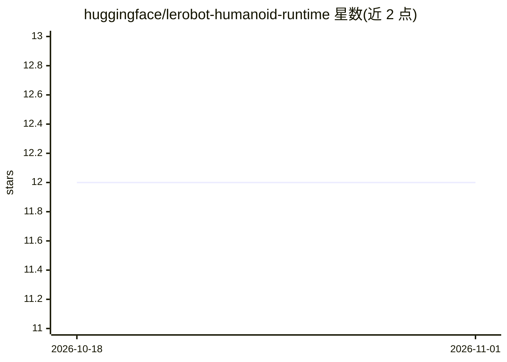

# huggingface/lerobot-humanoid-runtime

⭐ 12 · Python · Apache-2.0 · 推送 2026-08-27 · [GitHub](https://github.com/huggingface/lerobot-humanoid-runtime) · 组织维护

**12 自由度双足人形机器人的运行时与标定工具链**

面向一款 12 自由度（无臂）双足人形机器人的运行时与标定栈：包含 MuJoCo 仿真控制、真机控制（CAN MIT 协议 + IMU）、ONNX/Torch 强化学习策略推理 runner，以及 LeRobot 机器人集成模块。提供分级部署脚本（state_only 检查后再使能控制）、电机扫描、关节零位校准、IMU 标定等工具。部署前标定为强制要求，支持树莓派 5 / Ubuntu / Python 3.13，用 uv 管理环境。

## 筛选速览

| 维度 | 判定 | 备注 |
|---|---|---|
| AI 角色 | `ai-ecosystem` | LLM/agent 周边工具 |
| 许可风险 | `permissive` | Apache-2.0 |
| 部署形态 | `None` |  |
| 模型依赖 | — | README 未给出锁定关系 |
| 硬件要求 | — | 无带数字的原话,不猜 |
| 安装摩擦 | `low` | 无编译、无系统依赖或容器化 |
| 成熟度 | — | 结构信号不足 |

## 能力要点

- MuJoCo 仿真与真机 CAN（MIT 协议）双控制器
- ONNX/Torch RL 策略推理 runner 与分级安全部署流程
- LeRobot 机器人集成模块（LeRobotHumanoid）
- 电机扫描、关节零位、IMU 标定等 12 电机标定工具链

## 适用场景

- 在仿真与真机上部署 RL 行走策略并做安全分阶段上线
- 为该人形机器人做电机接线和关节零位标定
- 通过 LeRobot 框架接口操控该机器人
- 无硬件时用 mock CAN 总线验证控制与策略链路

## 场景标签

 · 领域:机器人/具身智能

## 证据(README 行号)

> L36: - `control/rl_agent.py`: policy inference runner (ONNX/Torch).
> L39: - `lerobot_humanoid_lerobot_integration/`: LeRobot robot implementation for this humanoid.

## 星数曲线

2026-10-18 12 → 2026-11-01 12（+0）

---
*卡片 v1 · prompt 1.4 · 生成 2026-11-01 · 置信度 high · 依据 README sha `697fd8ec71ff` · [字段定义](../../DATASET.md)*
