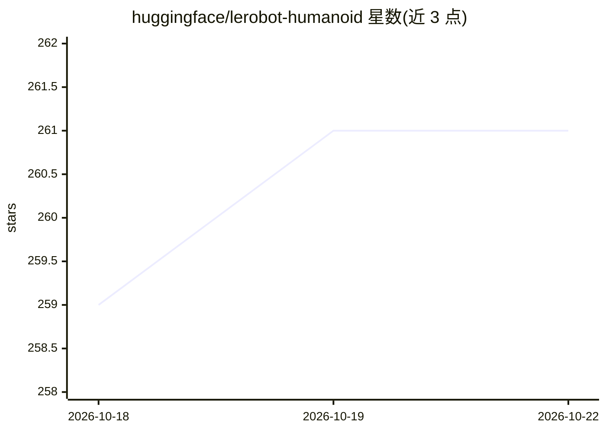

# huggingface/lerobot-humanoid

⭐ 261 · 推送 2026-08-10 · [GitHub](https://github.com/huggingface/lerobot-humanoid) · 个人维护

**低成本开源人形机器人全流程工作区：设计到部署**

聚合 LeRobot 人形机器人项目五个子仓库（design/hardware/model/runtime/identification）的 meta 工作区，覆盖机械与控制协同设计、硬件构建文档（BOM、STL、装配接线）、MJCF/URDF 机器人模型资产、真机与仿真运行时（控制器、标定、策略执行、LeRobot 集成），以及基于 MJWarp 回放与 CMA-ES 的仿真参数辨识。硬件成本目标低于 5000 美元，大部分自定义件可 3D 打印。每个子仓库为独立 Git 仓库。

## 筛选速览

| 维度 | 判定 | 备注 |
|---|---|---|
| AI 角色 | `ai-ecosystem` | LLM/agent 周边工具 |
| 许可风险 | `none` | — |
| 部署形态 | `None` |  |
| 模型依赖 | — | README 未给出锁定关系 |
| 硬件要求 | — | 无带数字的原话,不猜 |
| 安装摩擦 | `low` | 无编译、无系统依赖或容器化 |
| 成熟度 | — | 结构信号不足 |

## 能力要点

- 硬件成本目标低于 USD 5,000，大部分结构件 3D 打印可复现
- 五个子仓库覆盖从 CAD 设计到真机部署与参数辨识的完整链路
- runtime 提供控制器、标定流程与策略执行，集成 LeRobot
- identification 用 MJWarp 回放 + CMA-ES 拟合仿真参数

## 适用场景

- 从零构建一台可复现的低成本人形机器人
- 机器人仿真到真机的标定、策略执行与部署
- 通过真机数据回放辨识仿真参数以提升仿真保真度

## 场景标签

 · 领域:机器人/具身智能

## 证据(README 行号)

> L3: This workspace groups the full LeRobot humanoid project in one place, from design to deployment:
> L15: Build an open and practical **low-cost humanoid robot** that people can reproduce.
> L41: |`lerobot-humanoid-runtime`|`huggingface/lerobot-humanoid-runtime`|Real robot + simulation runtime, calibration, po

## 星数曲线

2026-10-18 259 → 2026-10-22 261（+2）

---
*卡片 v1 · prompt 1.4 · 生成 2026-10-22 · 置信度 high · 依据 README sha `ded03531af9d` · [字段定义](../../DATASET.md)*
