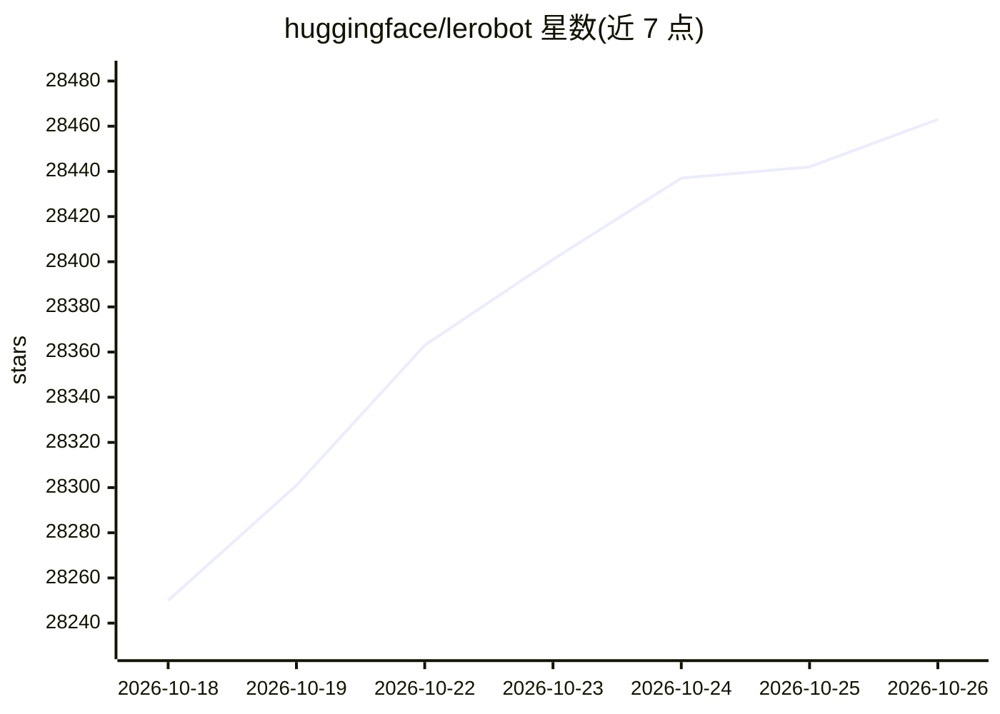

# huggingface/lerobot

⭐ 28,463 · Python · Apache-2.0 · 推送 2026-10-25 · [GitHub](https://github.com/huggingface/lerobot) · [官网](https://huggingface.co/docs/lerobot) · 组织维护 · 中文 README

**为机器人提供模型、数据集与工具的开源库**

Hugging Face 的机器人学 PyTorch 库：提供统一的 Robot 硬件控制接口（覆盖 SO100、LeKiwi、Reachy2 等原生支持型号）、托管于 HF Hub 的 LeRobotDataset 数据格式（Parquet+MP4）及配套工具、纯 PyTorch 实现的策略模型（涵盖模仿学习、强化学习、VLA、世界模型、奖励模型五类），并提供 lerobot-train 与 lerobot-eval 训练评估脚本，支持 LIBERO、MetaWorld 基准。通过 lerobot_ 前缀包名机制自动发现社区硬件插件。面向机器人研究者与开发者。

## 筛选速览

| 维度 | 判定 | 备注 |
|---|---|---|
| AI 角色 | `ai-ecosystem` | LLM/agent 周边工具 |
| 许可风险 | `permissive` | Apache-2.0 |
| 部署形态 | `library` | 以包/库形式分发 |
| 模型依赖 | — | README 未给出锁定关系 |
| 硬件要求 | — | 无带数字的原话,不猜 |
| 安装摩擦 | `low` | 无编译、无系统依赖或容器化 |
| 成熟度 | — | 结构信号不足 |

## 动量与使用信号

- 维护:`active` — 距上次 push 1.2 天,年发版 9,274 位贡献者
- 涨星:近 1 天 **+32**(自 20261016 起算)
- 安装:pypi 包 `lerobot` 月下载 237,322

## 能力要点

- 统一 Robot 类接口解耦控制逻辑与硬件，原生支持 SO100、LeKiwi、Unitree G1 等设备
- LeRobotDataset 标准数据格式托管于 HF Hub，支持流式读取与可视化
- 提供五类策略模型：模仿学习、强化学习、VLA、世界模型、奖励模型
- 社区硬件插件按包名前缀自动发现与接入

## 适用场景

- 为低成本的机械臂采集、训练和部署操作策略
- 在 LIBERO、MetaWorld 基准上评估策略
- 在 Hub 上存储与共享大规模机器人数据集
- 接入第三方机械臂等硬件并录制遥操作数据

## 场景标签

 · 领域:机器人/机器学习

## 证据(README 行号)

> L12: **LeRobot** aims to provide models, datasets, and tools for real-world robotics in PyTorch. The goal is to lower th
> L47: **Supported Hardware:** SO100, LeKiwi, Koch, HopeJR, OMX, EarthRover, Reachy2, Gamepads, Keyboards, Phones, OpenARM
> L72: LeRobot implements state-of-the-art policies in pure PyTorch, covering Imitation Learning, Reinforcement Learning, 

## 星数曲线

2026-10-18 28,250 → 2026-10-26 28,463（+213）

---
*卡片 v1 · prompt 1.4 · 生成 2026-10-18 · 置信度 high · 依据 README sha `57c3c7ba757c` · [字段定义](../../DATASET.md)*
