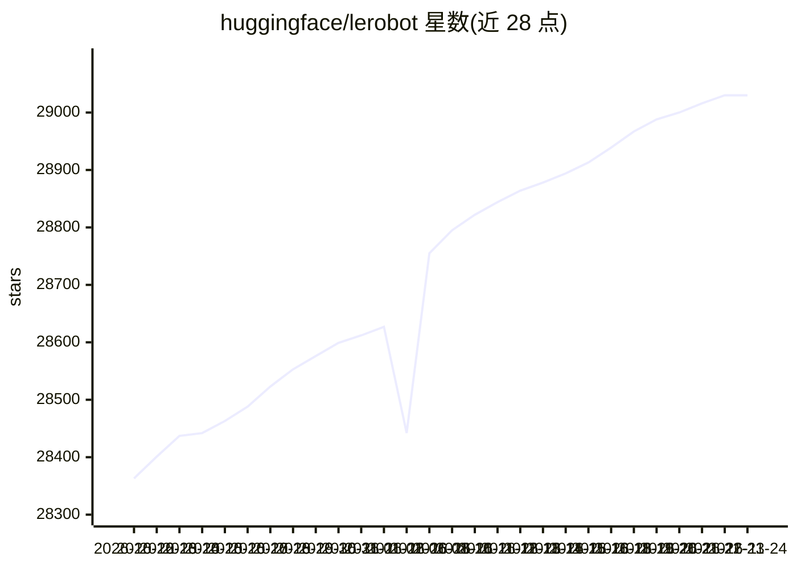

# huggingface/lerobot

⭐ 29,053 · Python · Apache-2.0 · 推送 2026-11-23 · [GitHub](https://github.com/huggingface/lerobot) · [官网](https://huggingface.co/docs/lerobot) · 组织维护 · 中文 README

**机器人端到端学习的 PyTorch 库：模型、数据集与工具**

面向真实世界机器人的 PyTorch 库，提供三部分：硬件无关的 Robot 统一控制接口（覆盖 SO101、Unitree G1、LeKiwi 等设备，可通过插件扩展）；托管在 Hugging Face Hub 上的 LeRobotDataset 标准数据格式（Parquet + MP4），附带数据切分、合并等工具；以及模仿学习、强化学习、VLA、世界模型、奖励模型等策略的纯 PyTorch 实现，含训练脚本与仿真评测（LIBERO、MetaWorld）。面向机器人开发者与研究者，通过 PyPI 安装并按需加载 extras。

## 筛选速览

| 维度 | 判定 | 备注 |
|---|---|---|
| AI 角色 | `ai-native` | 本体是模型或模型工具 |
| 许可风险 | `permissive` | Apache-2.0 |
| 部署形态 | `library` | 以包/库形式分发 |
| 模型依赖 | — | README 未给出锁定关系 |
| 硬件要求 | — | 无带数字的原话,不猜 |
| 安装摩擦 | `low` | 无编译、无系统依赖或容器化 |
| 成熟度 | — | 结构信号不足 |

## 动量与使用信号

- 维护:`active` — 距上次 push 1.2 天,年发版 9,274 位贡献者
- 涨星:近 1 天 **+32**(自 20261016 起算)
- 安装:pypi 包 `lerobot` 月下载 237,322

## 能力要点

- 统一 Robot 接口，硬件无关地控制多种机械臂与人形机器人
- LeRobotDataset 标准格式（Parquet+MP4）托管于 Hugging Face Hub
- 实现 ACT、Diffusion、Pi0、GR00T N1.7、SmolVLA 等策略及 lerobot-train 训练脚本
- lerobot-eval 支持 LIBERO、MetaWorld 等基准评测，第三方硬件插件自动发现

## 适用场景

- 为低成本机械臂采集、训练并部署操作策略
- 在 LIBERO/MetaWorld 仿真基准中评测策略
- 将机器人数据集以标准格式发布到 Hugging Face Hub
- 通过插件接入自定义机器人本体进行遥操作与数据记录

## 场景标签

`模型评测` `强化学习` · 领域:评测与运维

## 证据(README 行号)

> L12: **LeRobot** aims to provide models, datasets, and tools for real-world robotics in PyTorch. The goal is to lower th
> L74: LeRobot implements state-of-the-art policies in pure PyTorch, covering Imitation Learning, Reinforcement Learning, 

## 星数曲线

2026-10-22 28,363 → 2026-11-24 29,030（+667）

---
*卡片 v1 · prompt 1.4 · 生成 2026-11-22 · 置信度 high · 依据 README sha `4c4ce4a0d537` · [字段定义](../../DATASET.md)*
