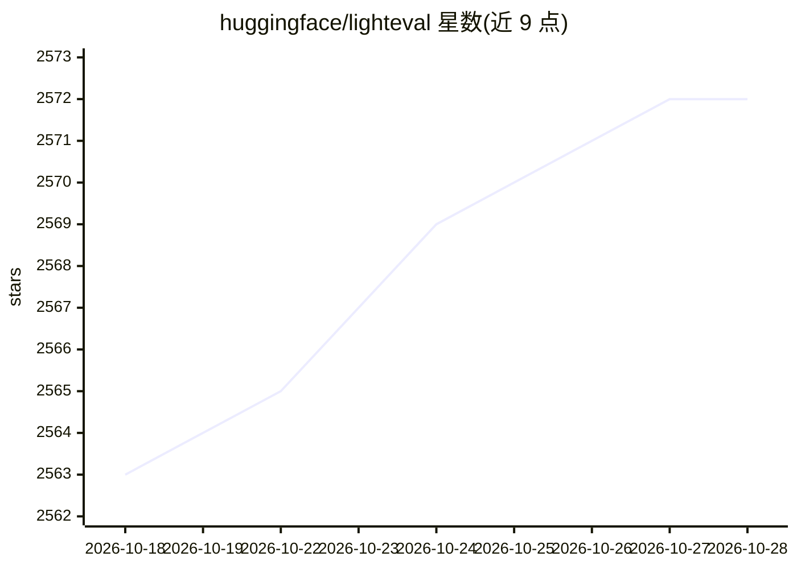

# huggingface/lighteval

⭐ 2,572 · Python · MIT · 推送 2026-10-28 · [GitHub](https://github.com/huggingface/lighteval) · [官网](https://huggingface.co/docs/lighteval/en/index) · 组织维护

**Hugging Face 出品的 LLM 多后端评测工具包**

由 Hugging Face Leaderboard 与 Evals 团队维护的 LLM 评测框架：支持 1000+ 评测任务，覆盖知识、数学与代码、对话模型评测、多语言（含中文 CMMLU/CEval）与语言理解等基准。提供多种评测入口——基于 inspect-ai 的 eval、Accelerate CPU/多 GPU、Nanotron 分布式、vLLM、SGLang，以及 Inference Endpoints/TGI/LiteLLM 等推理端点后端；也支持通过 Python API 评测已加载到内存的模型，可保存逐样本结果用于调试，并支持自定义任务与指标。以 pip 安装，Windows 目前未经测试。

## 筛选速览

| 维度 | 判定 | 备注 |
|---|---|---|
| AI 角色 | `ai-ecosystem` | LLM/agent 周边工具 |
| 许可风险 | `permissive` | MIT |
| 部署形态 | `library` | 以包/库形式分发 |
| 模型依赖 | local-ok | 支持本地模型 |
| 硬件要求 | — | 无带数字的原话,不猜 |
| 安装摩擦 | `low` | 无编译、无系统依赖或容器化 |
| 成熟度 | — | 结构信号不足 |

## 能力要点

- 1000+ 评测任务，覆盖知识/数学/对话/多语言/语言理解等基准
- 多种后端入口：inspect-ai、Accelerate、Nanotron、vLLM、SGLang、多种推理端点（含 LiteLLM 任意兼容 API）
- 保存逐样本详细结果用于调试
- 支持自定义任务与自定义指标

## 适用场景

- 我在多个后端（本地 GPU 或远程 API）上评测 LLM 的基准表现
- 我需要逐样本结果来调试模型在哪些题上出错
- 我想用自定义任务和指标评测自己的模型

## 场景标签

`模型评测` · 领域:评测与运维

## 证据(README 行号)

> L18: **Lighteval** is your *all-in-one toolkit* for evaluating LLMs across multiple
> L27: Lighteval supports **1000+ evaluation tasks** across multiple domains and

## 星数曲线

2026-10-18 2,563 → 2026-10-28 2,572（+9）

---
*卡片 v1 · prompt 1.4 · 生成 2026-10-21 · 置信度 high · 依据 README sha `3460e4355f8a` · [字段定义](../../DATASET.md)*
