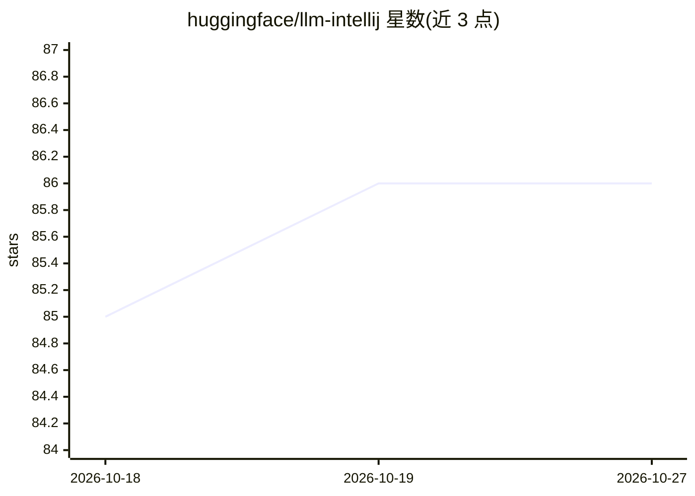

# huggingface/llm-intellij

⭐ 86 · Kotlin · Apache-2.0 · 推送 2026-09-29 · [GitHub](https://github.com/huggingface/llm-intellij) · 组织维护

**IntelliJ 的 LLM 代码补全插件，经 llm-ls 后端请求模型**

面向 IntelliJ 用户的 LLM 插件：提供类 Copilot 的 ghost-text 代码补全，补全请求经后端 llm-ls 以 HTTP 方式发出。端点可选 Hugging Face Inference API 或自建 HTTP 端点（需符合指定 API），README 称与任何能生成代码的模型兼容，并给出 Starcoder、CodeLlama 的默认 JSON 配置。用 tokenizers 统计 token 数以保证提示词适配上下文窗口；llm-ls 二进制在插件首次加载时自动下载，也可手动指定路径。API token 仅支持在插件设置中直接配置，HF_HOME 与 huggingface-cli 登录方式标注为尚未支持。

## 筛选速览

| 维度 | 判定 | 备注 |
|---|---|---|
| AI 角色 | `ai-ecosystem` | LLM/agent 周边工具 |
| 许可风险 | `permissive` | Apache-2.0 |
| 部署形态 | `desktop` | 安装包/桌面程序 |
| 模型依赖 | — | README 未给出锁定关系 |
| 硬件要求 | — | 无带数字的原话,不猜 |
| 安装摩擦 | `low` | 无编译、无系统依赖或容器化 |
| 成熟度 | `idea` | |

## 能力要点

- ghost-text 代码补全（类 Copilot）
- 支持 Hugging Face Inference API 或自建 HTTP 端点
- prompt 自动裁剪以适配上下文窗口（基于 tokenizers）
- llm-ls 二进制首次加载时自动下载，可自定义路径与日志级别

## 适用场景

- 在 IntelliJ 中获得代码补全建议
- 通过自建端点在本地或私有服务上跑代码补全
- 在插件设置中配置 Starcoder / CodeLlama 等代码生成模型

## 场景标签

`代码生成` · 领域:编码与开发

## 证据(README 行号)

> L3: **llm-intellij** is a plugin for all things LLM. It uses **llm-ls** as a backend.
> L14: This plugin supports "ghost-text" code completion, à la Copilot.
> L20: You can use the Hugging Face Inference API or your own HTTP endpoint, provided it adheres to the API specified here

## 星数曲线

2026-10-18 85 → 2026-10-27 86（+1）

---
*卡片 v1 · prompt 1.4 · 生成 2026-10-24 · 置信度 high · 依据 README sha `abfbba32a266` · [字段定义](../../DATASET.md)*
