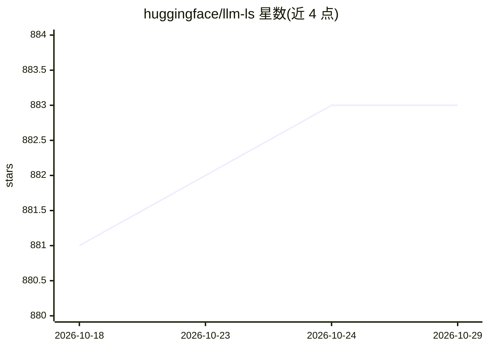

# huggingface/llm-ls

⭐ 883 · Rust · Apache-2.0 · 推送 2026-09-23 · [GitHub](https://github.com/huggingface/llm-ls) · 组织维护

**利用 LLM 做代码补全的 LSP 服务器，供 IDE 扩展接入**

面向 IDE 扩展开发者的 LSP 服务器：解析代码 AST 判断补全为多行、单行或空，以当前文件为上下文生成提示词（支持 fill-in-the-middle），并对提示词分词以确保不超出模型上下文窗口。后端兼容 Hugging Face Inference API、text-generation-inference、ollama 及 OpenAI 兼容 API（如 llama.cpp 的 Python server 绑定）。遥测数据仅存本地日志文件，不对外导出。兼容扩展包括 llm.nvim、llm-vscode、llm-intellij。项目自述为进行中状态，可能存在问题。

## 筛选速览

| 维度 | 判定 | 备注 |
|---|---|---|
| AI 角色 | `ai-ecosystem` | LLM/agent 周边工具 |
| 许可风险 | `permissive` | Apache-2.0 |
| 部署形态 | `None` |  |
| 模型依赖 | local-ok | 支持本地模型 |
| 硬件要求 | — | 无带数字的原话,不猜 |
| 安装摩擦 | `low` | 无编译、无系统依赖或容器化 |
| 成熟度 | `idea` | |

## 能力要点

- 解析 AST 判定补全类型（多行/单行/空）
- 支持多后端：HF Inference API、TGI、ollama、OpenAI 兼容 API
- 提示词分词以确保在模型上下文窗口内
- 遥测数据仅存本地日志，不导出任何数据

## 适用场景

- 为 Neovim/VSCode/IntelliJ 等编辑器扩展提供统一的 LLM 补全后端
- IDE 扩展开发者避免各自实现与 LLM API 的交互逻辑
- 通过 OpenAI 兼容 API 接入自托管推理服务

## 场景标签

`代码生成` · 领域:编码与开发

## 证据(README 行号)

> L6: **llm-ls** is a LSP server leveraging LLMs to make your development experience smoother and more efficient.
> L8: The goal of llm-ls is to provide a common platform for IDE extensions to be build on. llm-ls takes care of the heavy

## 星数曲线

2026-10-18 881 → 2026-10-29 883（+2）

---
*卡片 v1 · prompt 1.4 · 生成 2026-10-21 · 置信度 high · 依据 README sha `29084885a414` · [字段定义](../../DATASET.md)*
