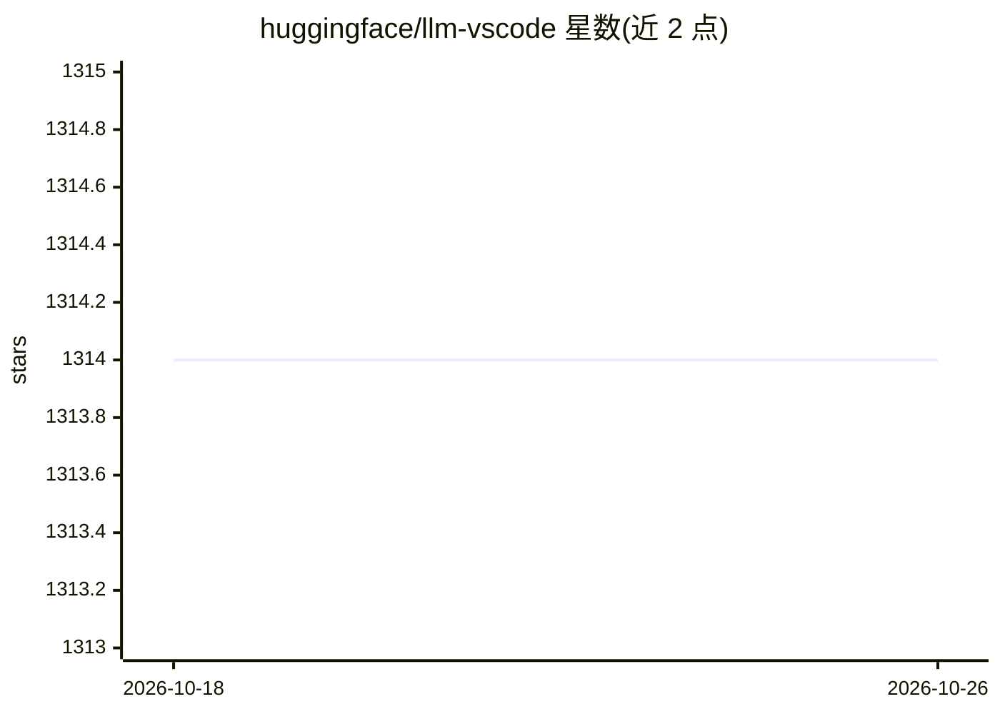

# huggingface/llm-vscode

⭐ 1,314 · TypeScript · Apache-2.0 · 推送 2026-09-23 · [GitHub](https://github.com/huggingface/llm-vscode) · 组织维护

**Hugging Face 的 VSCode LLM 代码补全扩展**

面向开发者的 VSCode 扩展，以 llm-ls 作为后端语言服务器，提供类似 Copilot 的 ghost-text 代码补全。推理请求经 HTTP 发送，后端可选 Hugging Face Inference API（默认，配 bigcode/starcoder）、Ollama、任意 OpenAI 兼容 API（如 llama-cpp-python）或 TGI；支持配置模型、tokenizer（本地文件/HF 仓库/HTTP 下载）与文档过滤，并保证 prompt 适配上下文窗口。附带生成代码溯源检查（The Stack Bloom filter）。安装方式为 VSCode 扩展常规安装，本地开发需自行构建 llm-ls（cargo）。

## 筛选速览

| 维度 | 判定 | 备注 |
|---|---|---|
| AI 角色 | `ai-native` | 本体是模型或模型工具 |
| 许可风险 | `permissive` | Apache-2.0 |
| 部署形态 | `None` |  |
| 模型依赖 | local-ok | 支持本地模型 |
| 硬件要求 | — | 无带数字的原话,不猜 |
| 安装摩擦 | `medium` | 含编译或系统依赖之一 |
| 成熟度 | — | 结构信号不足 |

## 能力要点

- ghost-text 代码补全，4 种后端（huggingface/ollama/openai 兼容/tgi）
- prompt 自动适配上下文窗口（tokenizers 计数）
- 生成代码溯源检查（The Stack Bloom filter + 完整索引二次检索）
- 同系列扩展覆盖 neovim/jupyter/intellij

## 适用场景

- 在 VSCode 中使用自选开源模型做代码补全
- 通过自有端点或本地 Ollama 接入补全，不依赖单一云服务
- 检查生成代码是否出现在 The Stack 数据集中

## 场景标签

`代码生成` · 领域:编码与开发

## 证据(README 行号)

> L3: **llm-vscode** is an extension for all things LLM. It uses **llm-ls** as its backend.
> L21: This plugin supports "ghost-text" code completion, à la Copilot.
> L27: You can use the Hugging Face Inference API or your own HTTP endpoint, provided it adheres to the APIs listed in bac

## 星数曲线

2026-10-18 1,314 → 2026-10-26 1,314（+0）

---
*卡片 v1 · prompt 1.4 · 生成 2026-10-21 · 置信度 mid · 依据 README sha `25aabe34a6a1` · [字段定义](../../DATASET.md)*
